import Figure from '@site/src/components/Figure';

:::info[Page details]

Describes the eCHIS web administration portal (OpenSRP 2 web, also called FHIR Web) as of 2 September 2026. Component overview: [Web administration portal](../architecture/components/web-admin.md).

:::

## Prerequisites

To follow this guide you need admin access to the admin portal. You also need to understand how the different entities tie to each other. Below is a summary.

A **user** represents anyone who will interact with the FHIR SDK-based app or FHIR Web. A user is assigned permission through **roles** defined in [Keycloak](../architecture/components/keycloak.md), which maintains all user authentication. Keycloak defines permissions in the form of roles that can be assigned to a user based on the activities they are expected to carry out. Because the list of roles is long, roles are grouped into **user groups**. User groups and their roles are created and maintained in Keycloak. FHIR Web shows a read-only view of them and lets you attach a user to a group.

A user who is expected to interact with the health workflows is assigned to a **care team**. A care team is then assigned to an **organization** (also known as a team). The organization is then assigned to a **location**, which is the lowest point in the hierarchy that a user is expected to work in while fulfilling the health workflows.

The steps below ensure a user is able to interact with the application.

1. Create the required user groups in Keycloak and assign their roles
2. Create or add the complete list of users in FHIR Web
3. Create the location hierarchy
4. Create organizations
5. Create care teams
6. Assign the organization to a location, which is the lowest point in the hierarchy that a user is expected to work in
7. Assign the created care team to the respective organization
8. Assign users to the care team

## Access to the admin portal

1. Open the eCHIS OpenSRP 2 web portal. For the reference and training environment the address is [https://echis-ref.dataforimplementation.org/](https://echis-ref.dataforimplementation.org/).
2. This loads the Keycloak sign-in page shown below.

<Figure caption="Sign in page" wide>

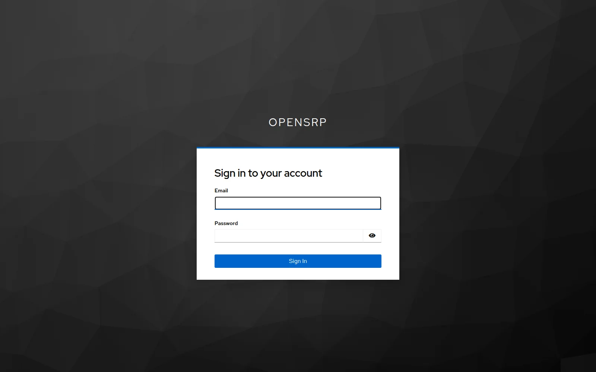

</Figure>

3. Enter your login credentials on the sign-in page. The first field is labelled **Email**. Enter your email and password, then click **Sign In**.
4. The landing page appears, with the features numbered on the figure below.

<Figure caption="Landing page features" wide>

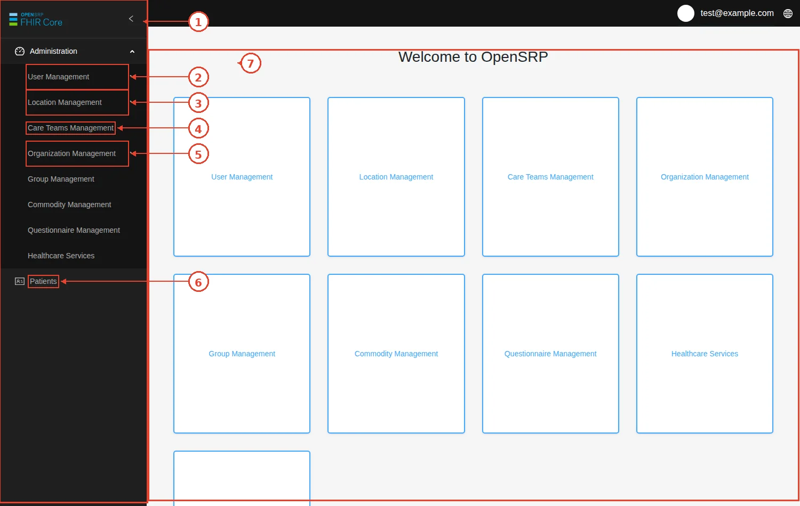

</Figure>

1. **Side menu**, a collection of menus that let you carry out management activities. Everything sits under **Administration**, with **Patients** listed separately.
2. **User Management**, which holds **Users** and **User Groups**
3. **Location Management**, which holds **Hierarchy** and **All Locations**
4. **Care Teams Management**, used to create care teams that administer the different services in the FHIR Core apps
5. **Organization Management**, which holds **Organizations** and **Organization Assignment**. Earlier versions called this Team Management
6. **Patients**, used to view the patients registered on the app and synced to the server
7. **Main landing page**, which has shortcuts to the side menu items

The portal also carries **Group Management**, **Commodity Management**, **Questionnaire Management** and **Healthcare Services**, which this guide does not yet cover.

<Figure caption="Side menu with all sections expanded" wide>

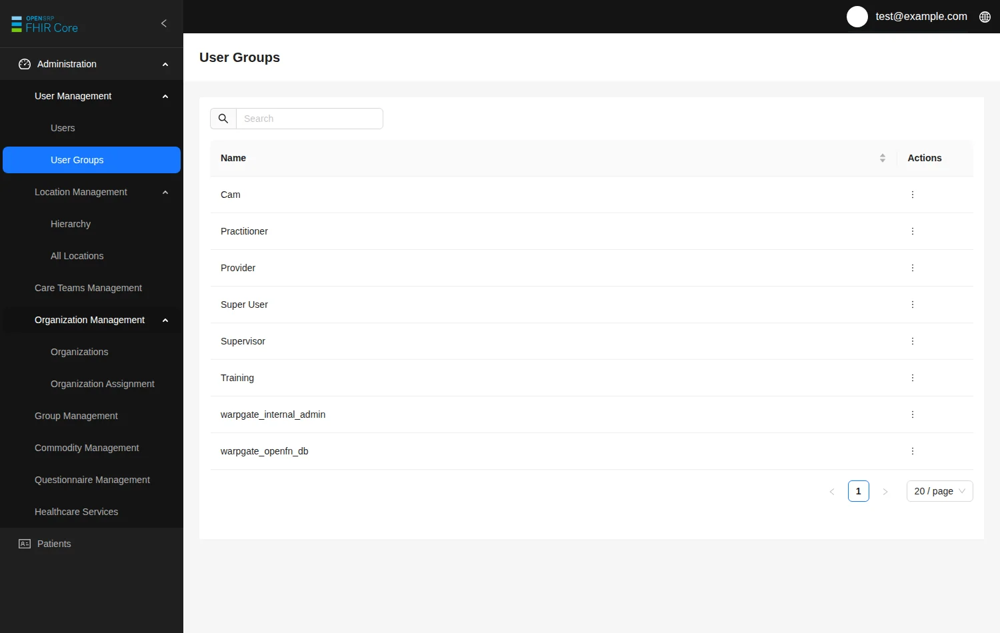

</Figure>

## User management

The OpenSRP web portal provides the ability to create users and attach them to an existing user group. User groups categorise users by the roles they share. On the reference environment the groups are Cam, Practitioner, Provider, Super User, Supervisor, Training, warpgate_internal_admin and warpgate_openfn_db. The **Provider** group refers to health workers whose main role is to collect data on the mobile application, while the **Super User** group refers to users who hold all the privileges, such as managing users, organizations and locations.

<Figure caption="User groups on the reference environment" wide>

</Figure>

### Viewing user groups

:::note

Creating user groups and assigning their roles were removed from the portal. Both are now done in Keycloak. The portal keeps a read-only view so you can confirm what a group holds.

:::

1. Click **User Management** in the side menu, then **User Groups**.

<Figure caption="User Management holds Users and User Groups. Earlier versions also listed User Roles">

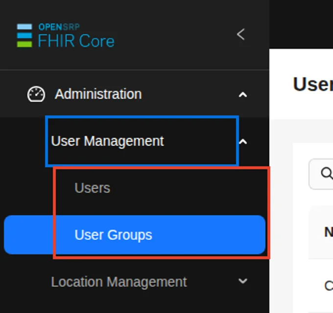

</Figure>

2. A page lists the existing user groups, with a search box and the columns Name and Actions.

<Figure caption="User Groups list" wide>

</Figure>

3. Open a group through the **Actions** column and choose **View Details**.
4. The detail view shows the group UUID, the group name, the roles assigned to it and its members. Nothing on this screen can be edited.

### How to create a user group and assign roles

Create the group and attach its roles in Keycloak, then return to the portal to confirm the result.

1. Sign in to the Keycloak administration console for your deployment and select the **opensrp** realm.
2. Open **Groups** in the left menu. The groups listed here are the same ones the portal shows under User Groups.

<Figure caption="Groups in Keycloak" wide>

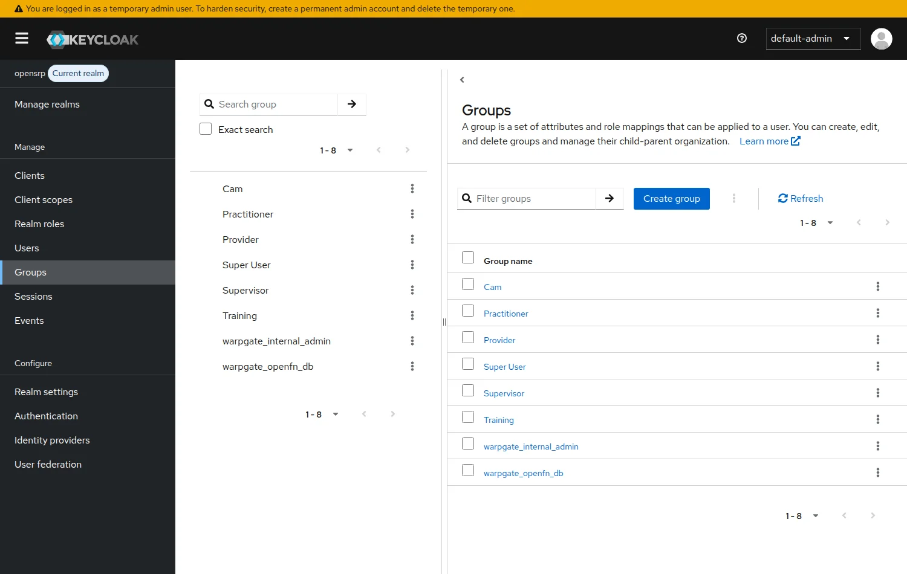

</Figure>

3. Open a group. The detail view carries the tabs **Child groups**, **Members**, **Attributes**, **Role mapping** and **Admin events**.
4. Open the **Role mapping** tab to see the roles held by the group, listed with the columns Name, Inherited and Description. Use **Assign role** to add a role and **Unassign** to remove one. Untick **Hide inherited roles** to include roles inherited from a parent group.

<Figure caption="Role mapping for a group" wide>

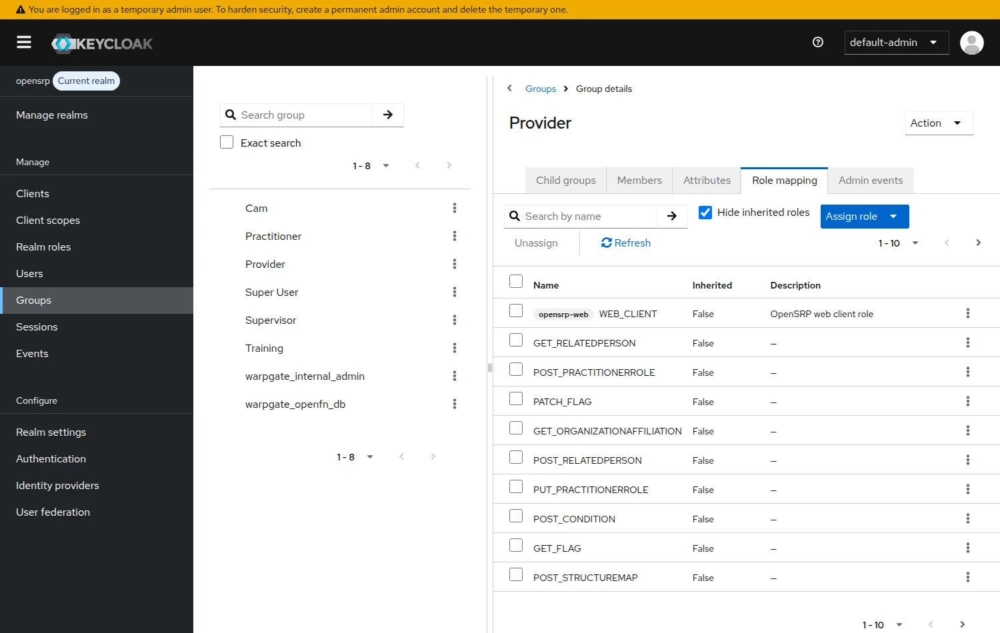

</Figure>

5. Back in the portal, open **User Management**, then **User Groups**, and use **View Details** to confirm the roles now listed against the group.

Assign a user to a group from the portal when you create or edit the user, through the **Keycloak User Group** field described below.

### How to create a user

1. Click **User Management** in the side menu, then **Users**.
2. A page lists the existing users with the columns First name, Last name, Username and Actions.
3. Click the **Add User** button on the top right of the screen.
4. A form opens for the user details. Fields with asterisks must be filled. The form asks for First Name, Last Name, Email, Username, Password, Confirm Password, User Type, Enable user, Keycloak User Group and Application ID. User Type offers **Practitioner** or **Supervisor**.

<Figure caption="The Users list and the Add User form">

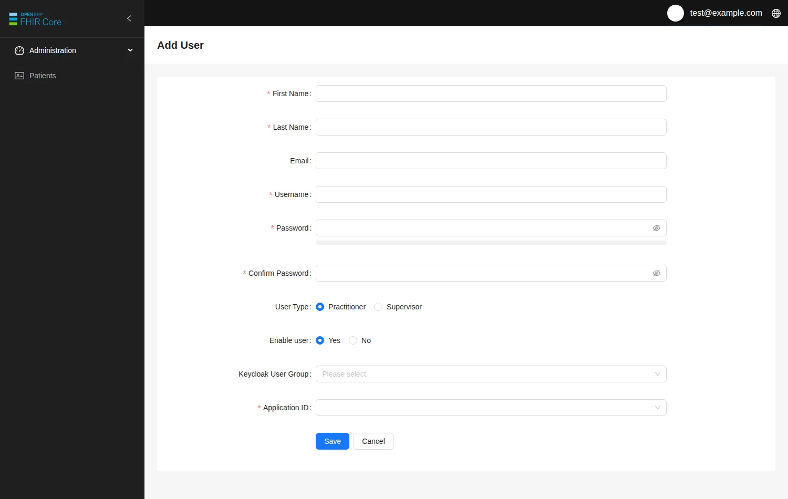

</Figure>

5. To assign the user to a particular user group, click the **Keycloak User Group** field and select the user groups.
6. Click **Save**.
7. You then need to set a password for the created user. Click the three dots in the **Actions** column beside that user. The menu offers **View Details**, **Reset password** and **Delete**.

<Figure caption="Actions menu for a user" wide>

</Figure>

8. Click **Reset password** from the menu.
9. Enter **New Password** and **Confirm Password** in the dialog that appears.
10. Click **Set password**.

<Figure caption="Reset password dialog" wide>

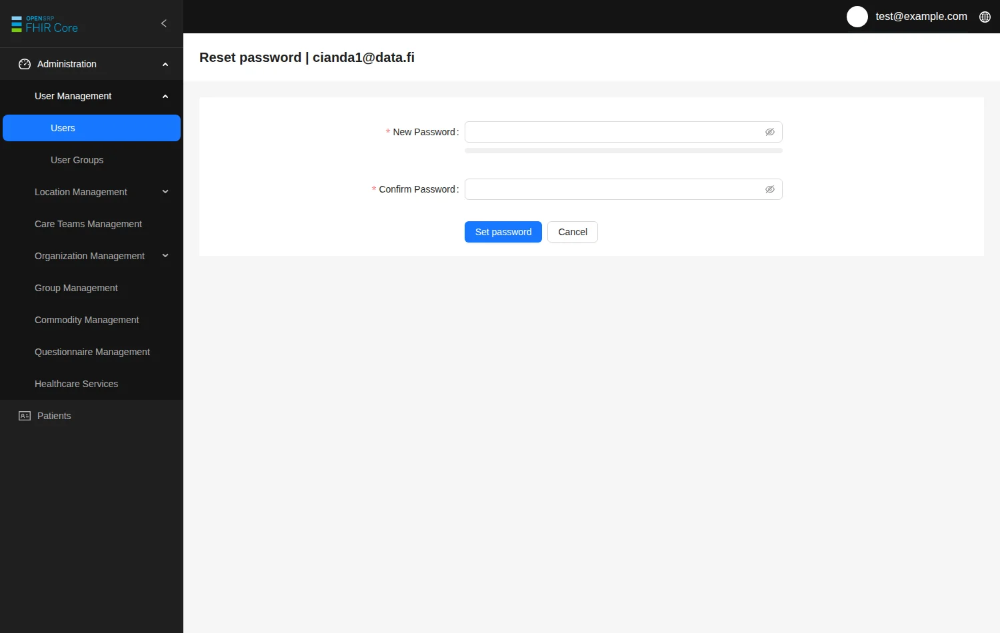

</Figure>

### How to update a user's details

1. Click **User Management** in the side menu, then **Users**.
2. A page lists the existing users.

<Figure caption="Finding a user in the Users list">

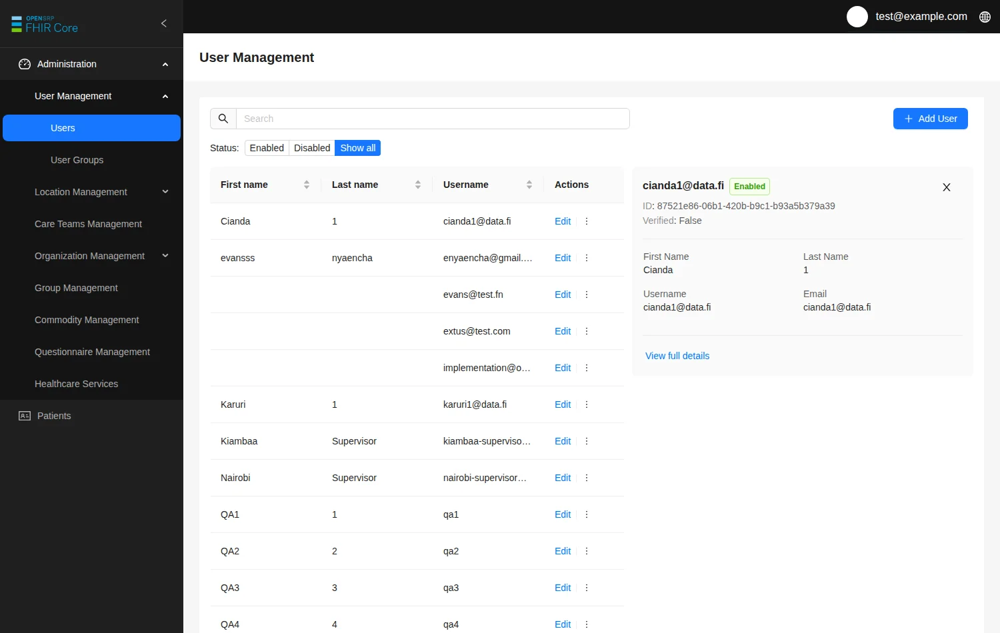

</Figure>

3. Open the user from the **Actions** column. In the build reviewed on 31 August 2026 the action is **View Details** rather than an Edit link.
4. A form opens for updating the user's details. Fields with asterisks must be filled.

<Figure caption="User details and the edit form">

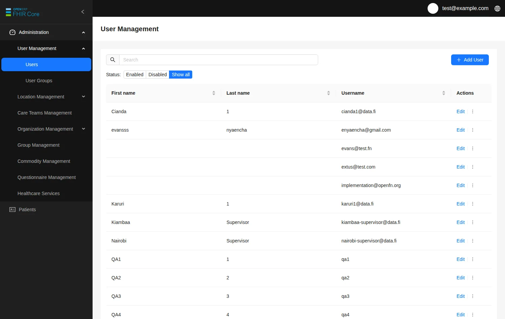

</Figure>

5. Click **Save**.

## Location management

This functionality lets you create locations and add a parent location for each one. It is based on the FHIR Location resource. A location hierarchy is defined by assigning parent locations. If a parent is not selected, the location is taken as a root location in the hierarchy.

### How to create a location unit

Open the page by clicking **Location Management** in the side menu, then **Hierarchy** or **All Locations**. A page lists the existing location units.

1. Click the **Add Location Unit** button on the top right of the screen.

<Figure caption="Location list with the Add Location Unit button" wide>

</Figure>

2. A form headed **Add Location Unit** opens, carrying the fields Id, Part Of, Name, Alias, Status, Physical type, Geometry and Description. Fields with asterisks must be filled. Status offers **Active** or **Inactive**, and Physical type offers **Jurisdiction** or **Building**. Use **Part Of** to place the location under a parent, and leave it empty to create a root location.
3. Click **Save**.

<Figure caption="Add Location Unit form" wide>

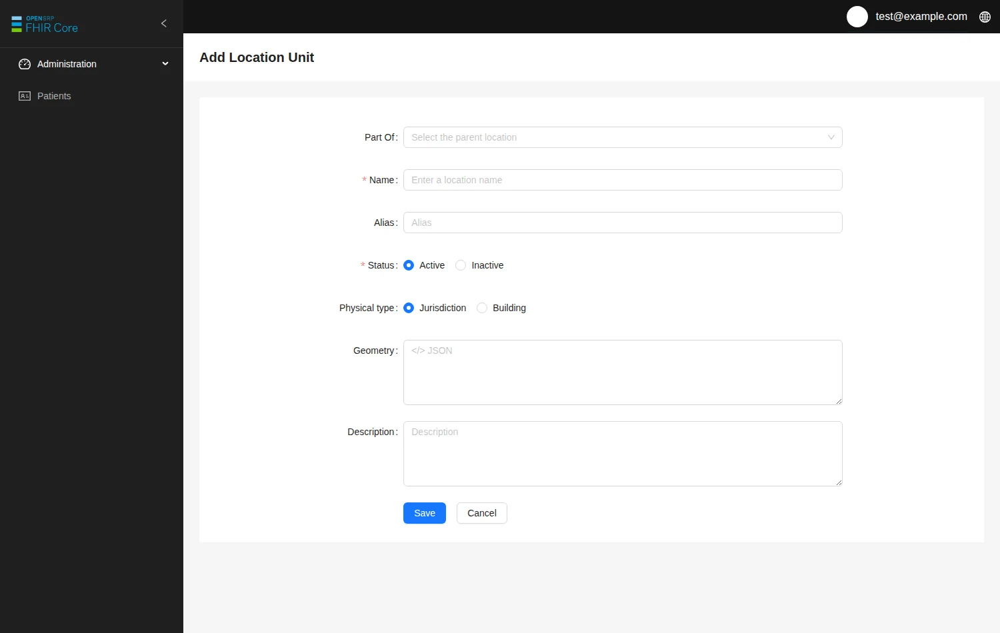

</Figure>

### How to update a location unit

Open the page by clicking **Location Management** in the side menu, then **Hierarchy** or **All Locations**. A page lists the existing location units.

1. Open the location from the **Actions** column.
2. A form opens for updating the location details. Fields with asterisks must be filled.

<Figure caption="Edit location form" wide>

</Figure>

3. Click **Save**.

## Care teams management

This functionality lets you create care teams that administer the different services in the FHIR Core apps. It also lets you add practitioners and groups to a care team.

### How to create a care team

Open the page by clicking **Care Teams Management** in the side menu. A page headed **FHIR Care Team** lists the existing care teams.

<Figure caption="FHIR Care Team list" wide>

</Figure>

1. Click the **Create Care Team** button on the top right of the screen.
2. A form headed **Create Care Team** opens, carrying the fields ID, UUID, Name, Status, Practitioner Participant and Managing organizations. Fields with asterisks must be filled. Status offers **Active** or **Inactive**.
3. To assign practitioners to the care team, click the **Practitioner Participant** field and select them.
4. To attach the care team to an organization, click the **Managing organizations** field and select it.
5. Click **Save**.

<Figure caption="Create Care Team form">

</Figure>

### How to update a care team's details

Open the page by clicking **Care Teams Management** in the side menu. A page lists the existing care teams.

<Figure caption="Care team list with the Actions column" wide>

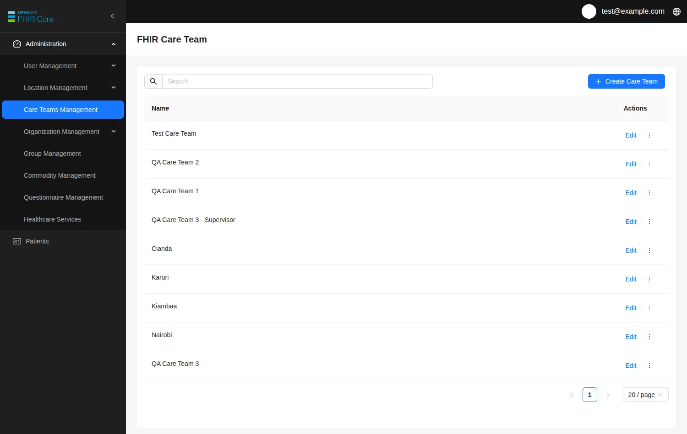

</Figure>

1. Open the care team you would like to update from the **Actions** column.
2. A form opens for updating the care team's details. Fields with asterisks must be filled.
3. Click **Save**.

<Figure caption="Care team details and the edit form">

</Figure>

## Organization management

:::note

This section was called Team Management in earlier versions. The portal now labels the menu **Organization Management**, with the sub-items **Organizations** and **Organization Assignment**.

:::

The FHIR Web organization management package lets you:

1. Create organizations, and assign practitioners to them
2. Assign organizations to locations

**Organizations** creates the organizations used to administer the different services in the FHIR Core apps, and adds practitioners to them. **Organization Assignment** assigns a location to an organization.

### Organizations

Open the page by clicking **Organization Management** in the side menu, then **Organizations**. A page headed **Organization list** opens.

1. Click the **Add Organization** button on the top right of the screen.
2. A form headed **Create organization** opens, carrying the fields Id, Identifier, Name, Alias, Status, Type and Practitioners. Fields with asterisks must be filled.

<Figure caption="The Add Organization button" wide>

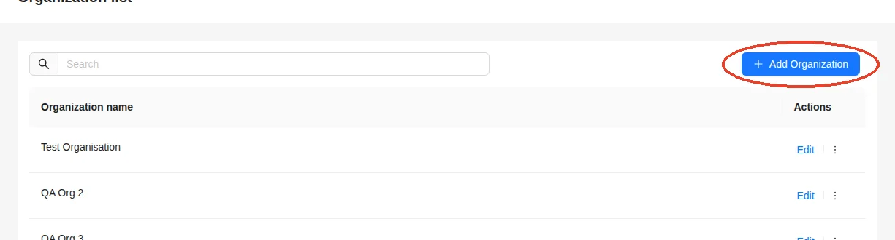

</Figure>

3. To assign practitioners to the organization, click the **Practitioners** field and select them.
4. Click **Save**.
5. To complete the process, assign the organization to a location as described in [Organization assignment](#organization-assignment).

### How to update an organization

Open the page by clicking **Organization Management** in the side menu, then **Organizations**. A page lists the existing organizations.

1. Open the organization you would like to update from the **Actions** column.

<Figure caption="Organization list and the Actions column">

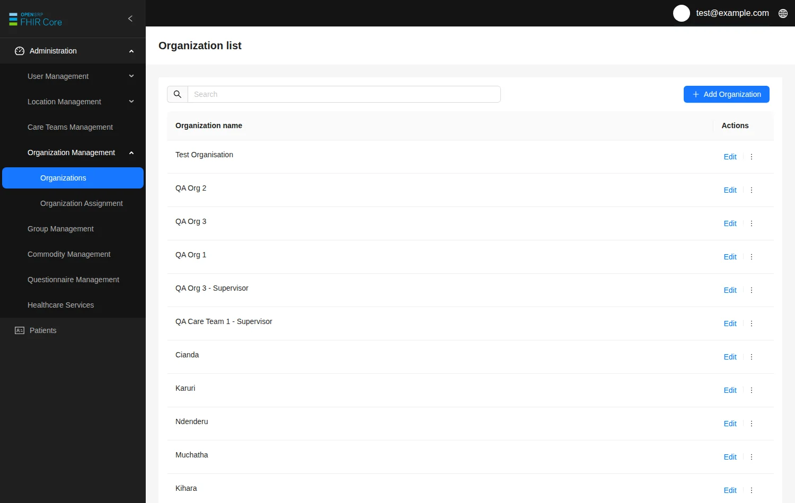

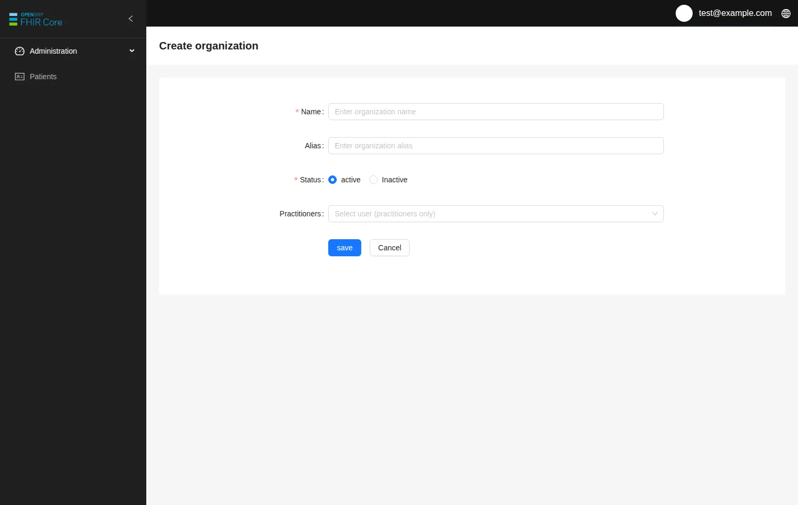

</Figure>

2. A form opens for updating the organization's details. Fields with asterisks must be filled.
3. Click **Save**.

### Organization assignment

:::note

Before proceeding with the steps below, ensure you have locations loaded in the system.

:::

Open the page by clicking **Organization Management** in the side menu, then **Organization Assignment**. The page is headed **Assign Organizations to Locations** and lists locations with the columns Name, Assigned organizations and Actions.

1. Search for the location in the search field. A list of results appears. Click the preferred location in the results, and it is shown in the section on the right.

<Figure caption="Assign Organizations to Locations">

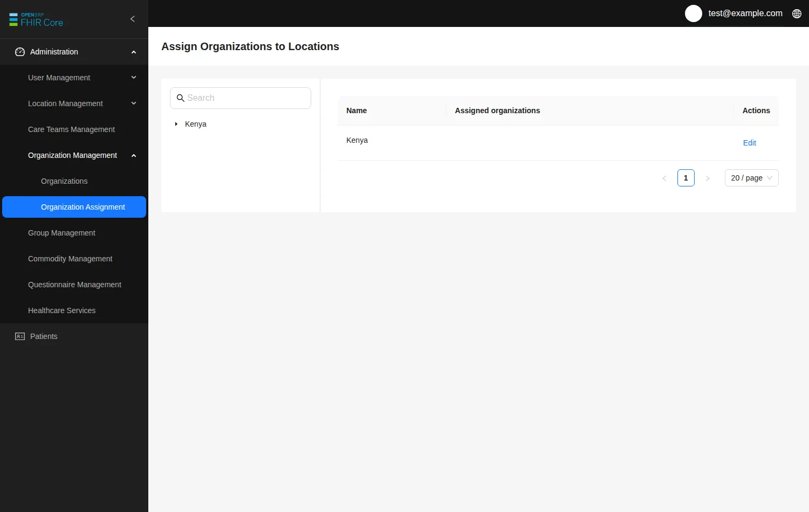

</Figure>

2. Open the location from the **Actions** column. A page appears that lets you assign organizations. Select the organizations to assign to the location.
3. To unassign an organization from a location, follow the same process and clear the organizations you want to remove.

## Patient management

The FHIR Web patients package lets you view the patients captured through the Android client and synced successfully. Reach it from **Patients** in the side menu or from the tile on the landing page. The list carries the columns Name, Date Of Birth, Status, Gender and Actions.

:::note

The Patients menu points at `/fhir/Patient`. Follow it from inside the portal rather than pasting the address into the browser, because opening it directly reaches the FHIR API rather than the portal page.

:::

Clicking **View** against a patient opens the details for that patient in a side panel.

<Figure caption="Patients list and the View action">

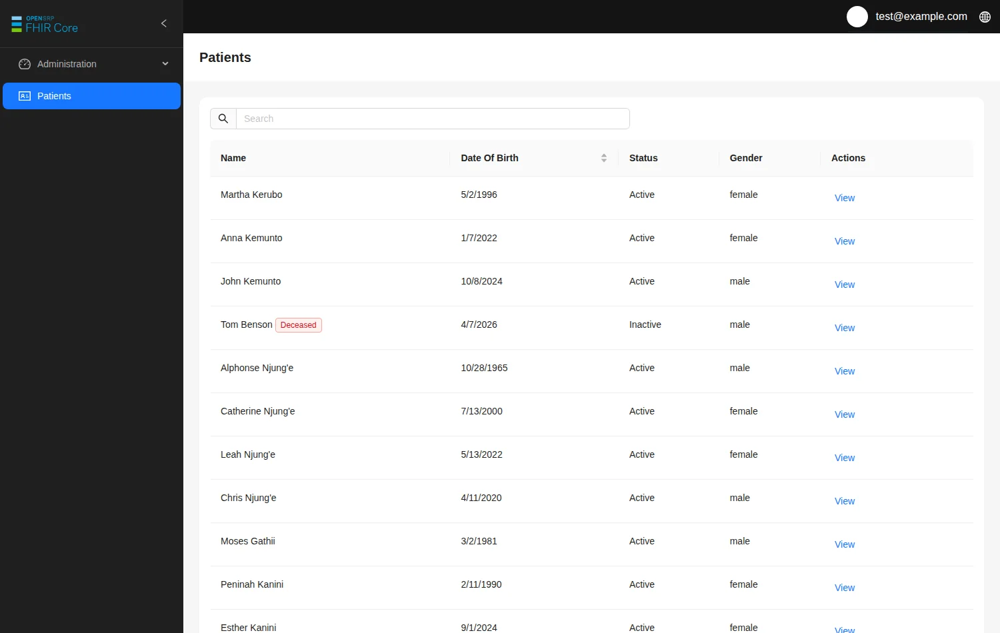

</Figure>

<Figure caption="Patient details side panel" wide>

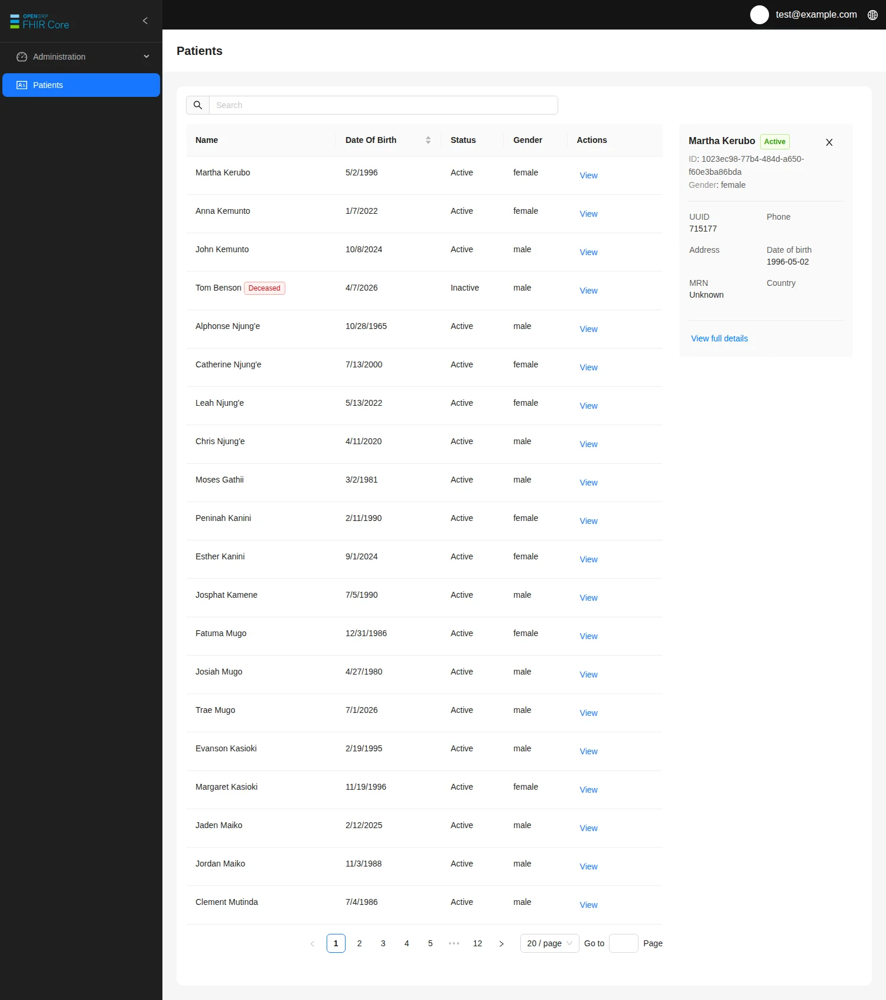

</Figure>

## Dashboards

### How to access the dashboards

:::note

This section could not be verified on 2 September 2026. The dashboard address recorded here, `https://echis-ref.dataforimplementation.org/superset/login/`, no longer resolves, so the screenshots below still show the 2023 Superset instance. Confirm the current Superset address with the platform team before following this section. Component overview: [Superset](../architecture/components/superset.md).

:::

The staging dashboard was accessible through that address. Users opening the link see the page below and follow these steps:

1. Click the login menu in the top right corner.
2. Enter the username and password and click **Sign in**.
3. After a successful login, select the reporting dashboard for your deployment to access the dashboards and charts. Older material calls this the ZEIR Reporting Dashboard.

<Figure caption="Superset login and dashboard list">

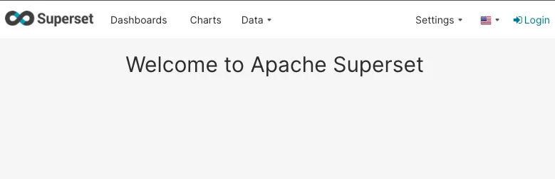

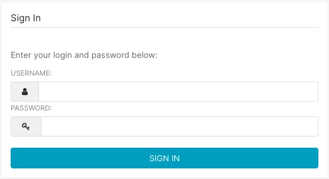

</Figure>

4. There are two main roles on the dashboard. The **Admin** role provides full access to the dashboard menus.
5. To update the dashboard roles for a user, log in with a user that has the Admin role.

### How to update dashboard user roles

When a user with an OpenSRP-based account logs into the dashboard, the user account is automatically added to the users table in Superset. The Admin user then follows these steps.

1. Click the settings menu in the top right corner and select **List Users**.
2. Identify the user whose details need to be updated in the listed users and click the edit (pencil) icon on the left of the user record.

<Figure caption="List Users and the edit icon">

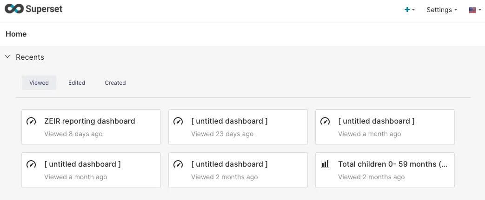

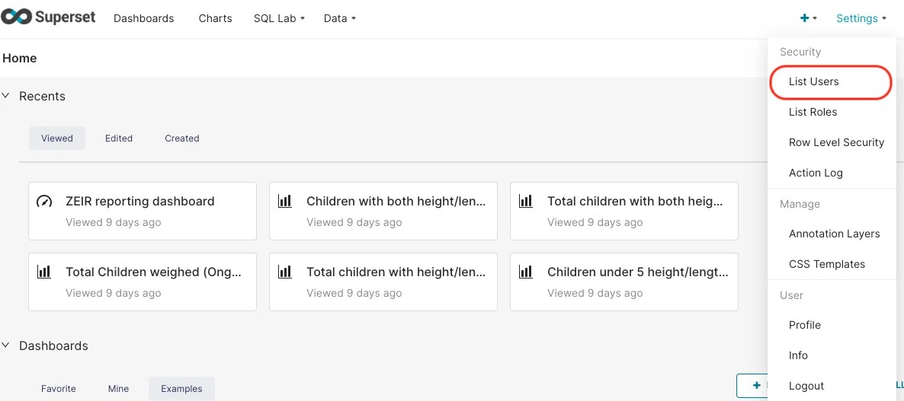

</Figure>

3. Update the user's first and last name as well as the role to be granted. Confirm the user account is marked as active, ensure all the fields with asterisks are completed, and save the record.
4. The user can log into the dashboard again or refresh the page to view the indicators.
5. The user should then select the **Dashboards** menu at the top to see the dashboard assigned to them. See the sample screenshot below.

<Figure caption="Editing a user and the dashboard assigned to them">

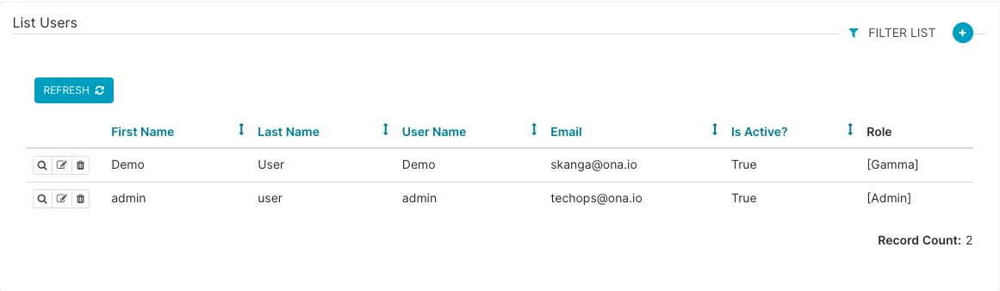

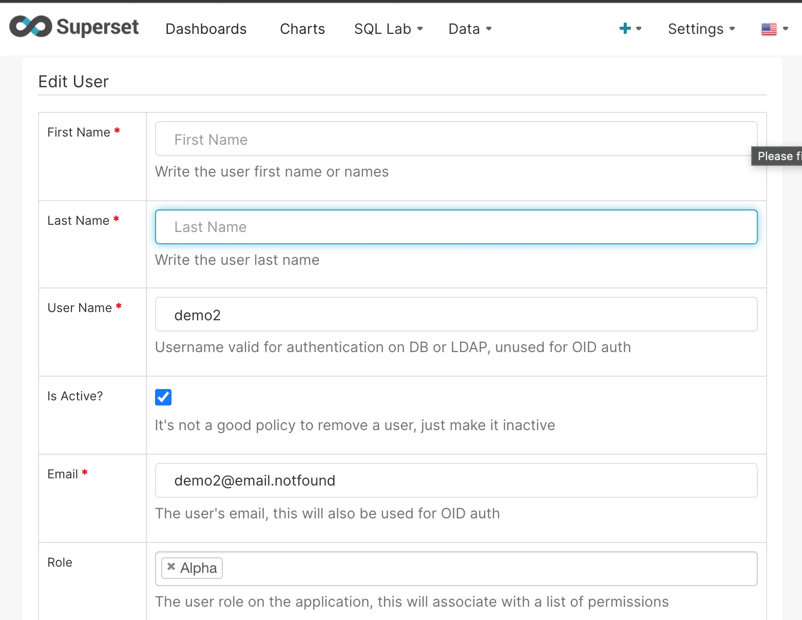

</Figure>

### Removing a user from the Superset dashboard

1. Log in to the Superset instance for your deployment with an account that has admin permissions. The address recorded in this guide no longer resolves.
2. Go to **Settings**, then **List Users**, in the top right corner. See the screenshot below.
3. On the user account to be deleted, click the delete icon attached to their record.

<Figure caption="Deleting a user from List Users">

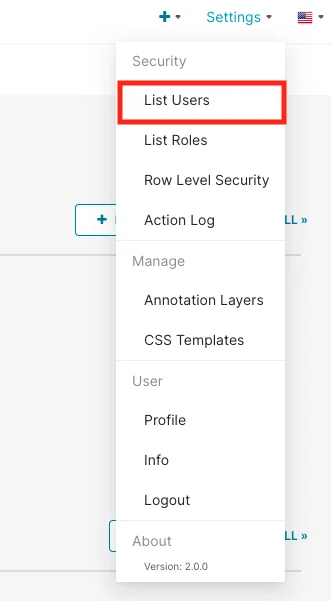

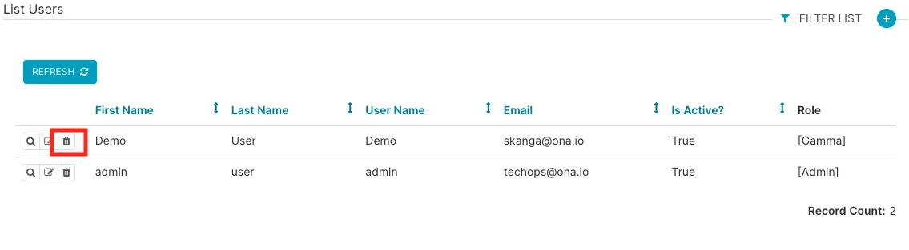

</Figure>
