import Figure from '@site/src/components/Figure';

:::info[Page details]

Describes the eCHIS supervisor application on OpenSRP 2 as of 2 September 2026. Component overview: [Supervisor app](../architecture/components/supervisor-app.md).

:::

## Getting started

### Entering the application ID

On a device where the app has not been set up before, the first screen asks for the application ID. Enter the ID given to you by the support team, which is `echisDataFiSupervisor` for the supervisor app, then tap **LOAD CONFIGURATIONS**. The app downloads its configuration and opens the login page.

<Figure caption="Application ID screen">

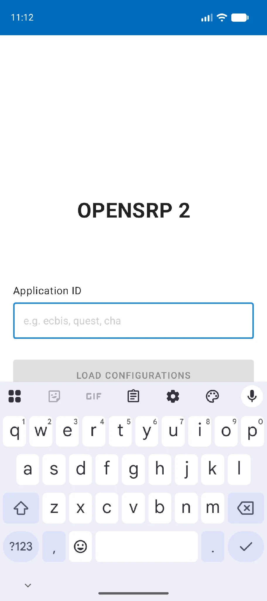

</Figure>

### Logging into the application

To log in you need the following.

- A connection to the internet

- A correct username and password

<Figure caption="Supervisor login page">

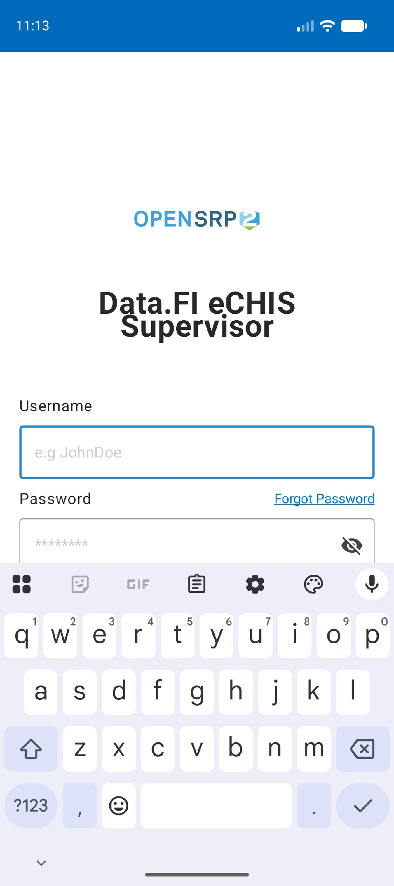

</Figure>

Enter your username and password, then tap **LOGIN**.

<Figure caption="Login page with credentials entered">

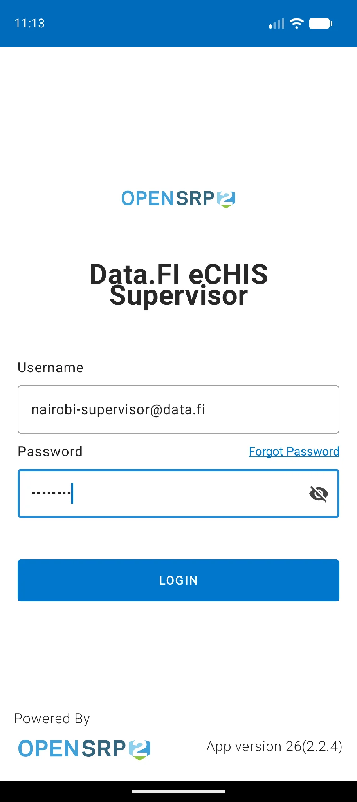

</Figure>

### Setting a PIN

After the first successful login the app asks you to choose a four digit PIN. Enter the PIN and tap **SET PIN**.

<Figure caption="Set PIN screen">

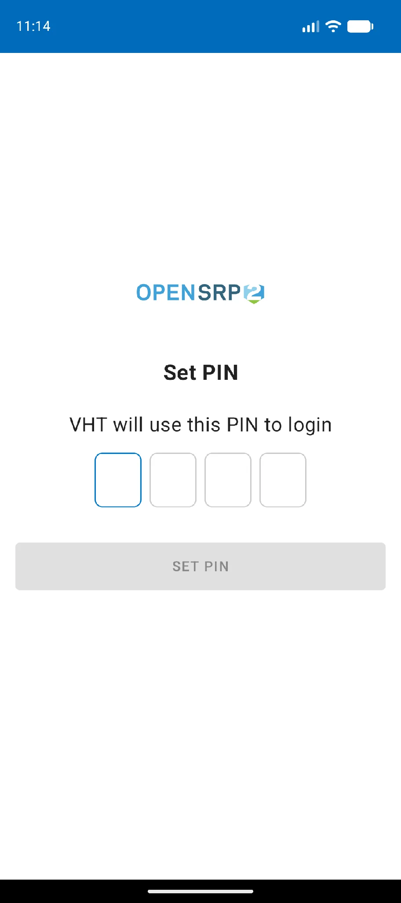

</Figure>

:::note

The subtitle is served from the app configuration rather than the app itself, through the `pin.message` value. On the reference server checked on 31 August 2026 it still read "VHT will use this PIN to login". A change to "Supervisor will use this PIN to login" is intended, so the wording you see may differ once that reaches your environment.

:::

### Initial sync

The first time you log in, let sync finish so that all forms and data load onto the device. The sync status shows as a percentage. You cannot act on the app until sync completes. Once it finishes you can disconnect from the internet and the app keeps full functionality. If sync fails you get the message "Sync failed. Check the internet connection or try again later".

### Subsequent logins

Once a PIN is set, later logins on the same device ask for the PIN rather than the username and password. This works offline.

<Figure caption="PIN entry for a returning user">

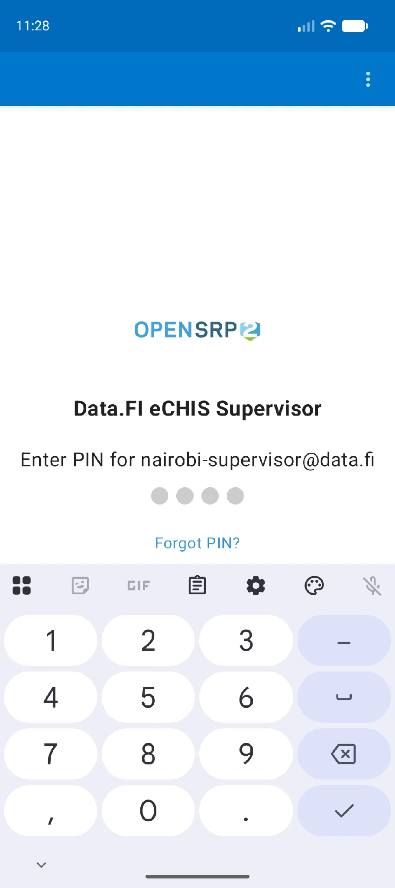

</Figure>

## Navigating the app

### The side menu

Tap the menu icon at the top left of any register to open the side menu. It lists the registers with a count against each, along with Reports and Profile, and it carries the manual sync control at the bottom with the time of the last sync.

<Figure caption="Side menu">

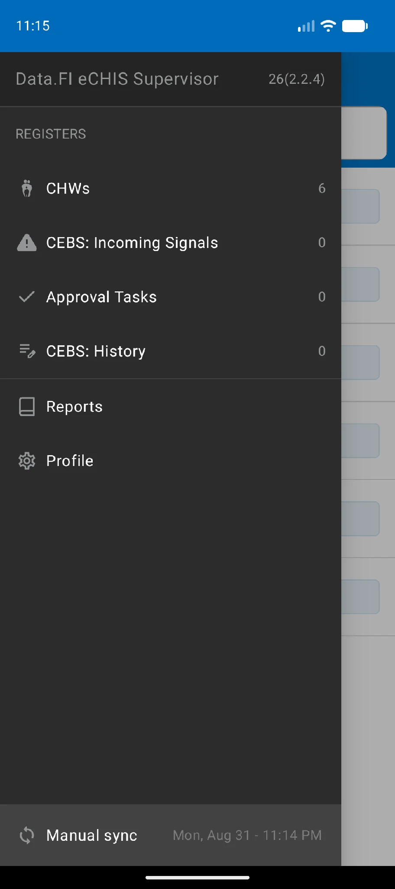

</Figure>

The menu holds the following.

- **CHWs**, the register of community health workers assigned to you

- **CEBS Incoming Signals**, community event based surveillance signals awaiting review

- **Approval Tasks**, items raised by CHWs that need your approval

- **CEBS History**, signals already handled

- **Reports**, monthly and full year summaries

- **Profile**, your account details and app settings

### Syncing data

Tap **Manual sync** at the bottom of the side menu to sync. The line beside it shows the time of the last sync, and it warns you when unsynced data is held on the device.

## The CHWs register

When you log in and the initial sync completes, the app opens the **CHWs** register listing the community health workers under the supervisor who is logged in.

:::note

CHWs, supervisors and their locations are assigned on the web administration interface.

:::

On this page you see the following.

- The name of the CHW

- The village they are assigned, shown against a location pin

- A **VHT Visit** button on the right of each row

- A search bar that filters by name

- A page counter at the foot of the list

<Figure caption="CHWs register">

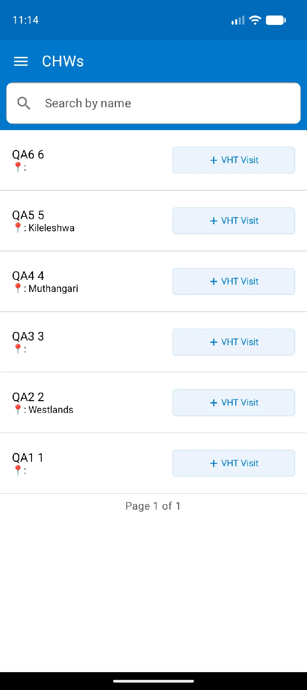

</Figure>

Tapping the name of a CHW opens their profile. Tapping **VHT Visit** on the right opens the supervisory visit form.

## The CHW profile

The profile shows the name of the CHW, the village they represent against a location pin, and a **VHT RECORDS** section listing the registers held on that CHW device.

<Figure caption="CHW profile">

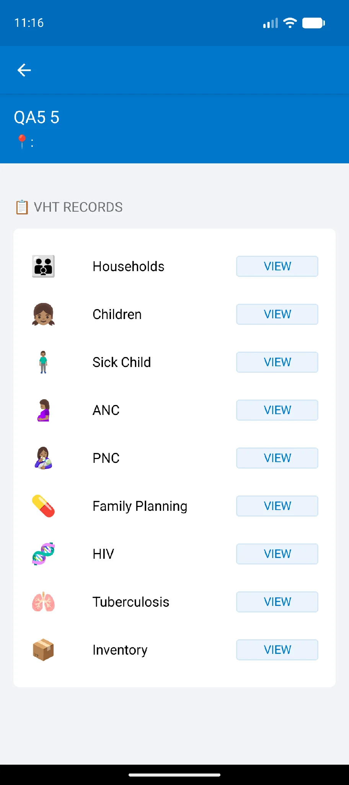

</Figure>

The registers listed are Households, Children, Sick Child, ANC, PNC, Family Planning, HIV, Tuberculosis and Inventory. Tap **VIEW** against any of them to open it.

### Viewing a CHW register

Opening a register shows the clients or commodities as they appear on the CHW device. The title carries the name of the CHW and the register, and a search bar filters the list. You cannot edit any of these records from the supervisor app.

<Figure caption="A CHW register opened from the profile">

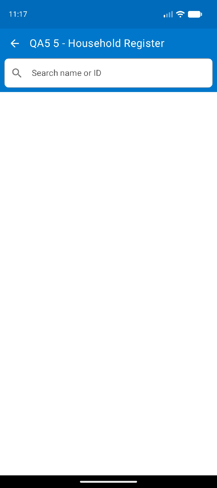

</Figure>

:::note

The registers were empty in the reference environment used for this guide, because no client records were synced for those CHWs.

:::

## The supervisory VHT visit form

Fill this form during or after a visit to a CHW. Open it from the **VHT Visit** button on the CHWs register.

<Figure caption="Opening the supervisory visit form">

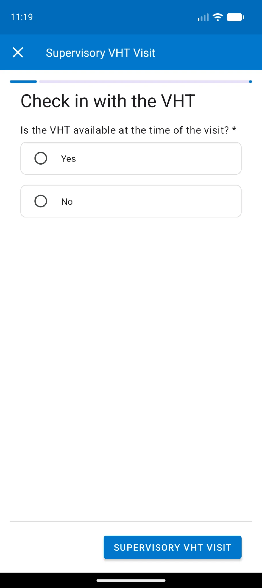

</Figure>

The form runs over several pages. Move through them with **NEXT** and **PREVIOUS**. Questions appear as you answer, so a page grows as you work down it.

### Check in with the VHT

Records whether the CHW was available and able to work, whether they have a working device, and what they are trained on.

- Is the VHT available at the time of the visit

- VHT is well and able to work

- Does the VHT have an assigned android device

- Is the android device functioning properly

- Did the VHT have any other challenges

- Modules the VHT is trained on, which offers Module 1 only, Module 1 and 2, Module 1 to 3, or Module 1 to 4

<Figure caption="Check in with the VHT">

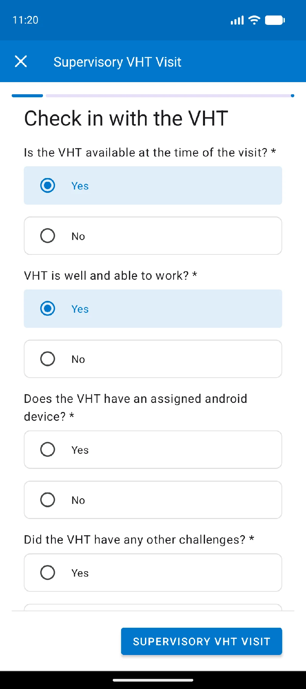

</Figure>

<Figure caption="Device and training questions">

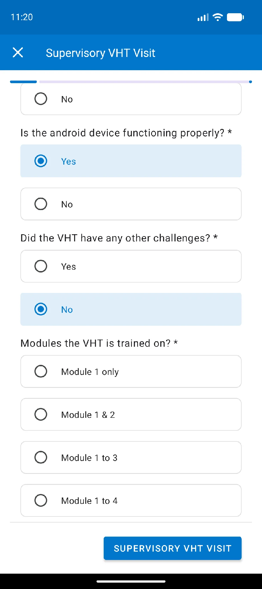

</Figure>

### Program management and data collection

A checklist of general activities covering an up to date workplan, correct completion of the monthly service report, engagement in at least one community meeting in the month, and referrals that need support.

<Figure caption="Program management and data collection">

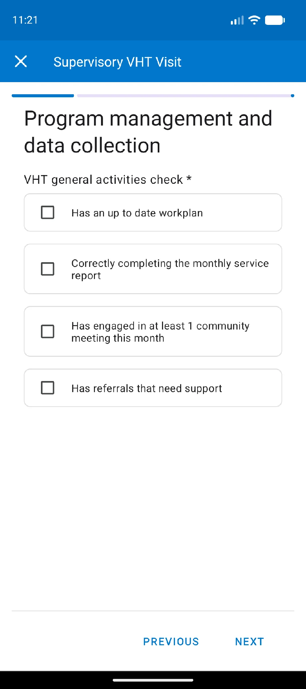

</Figure>

### Supply chain

Covers the stock physical count, damaged or expired stock, stock adjustment and restocking during the most recent supervisory visit.

<Figure caption="Supply chain">

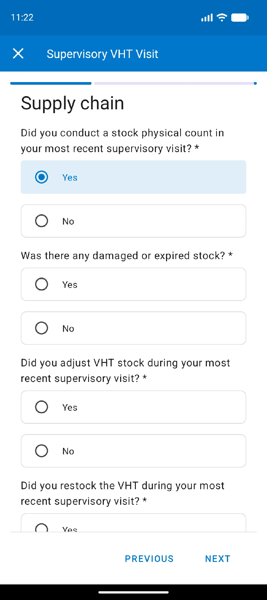

</Figure>

### Module activity pages

Four pages follow, one for each module, asking whether any activities for that module have been completed since the last visit.

<Figure caption="Module 1 page">

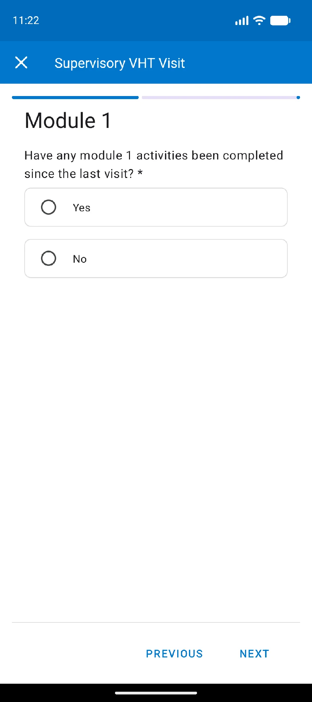

</Figure>

<Figure caption="Module 4 page">

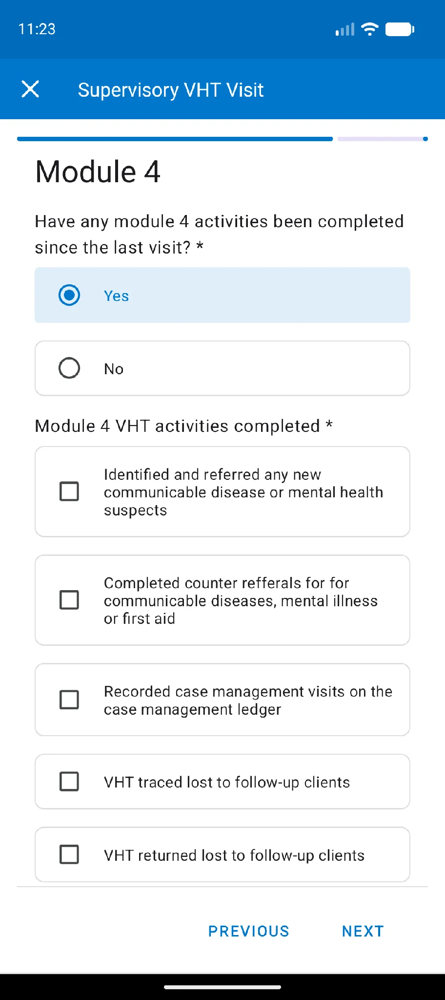

</Figure>

### Supervision visit summary

Closes the form by recording whether you reviewed at least one form and assessed it for correct treatment, how many reviews you conducted, how many had the correct treatment, and whether you conducted an observational home visit.

<Figure caption="Supervision visit summary">

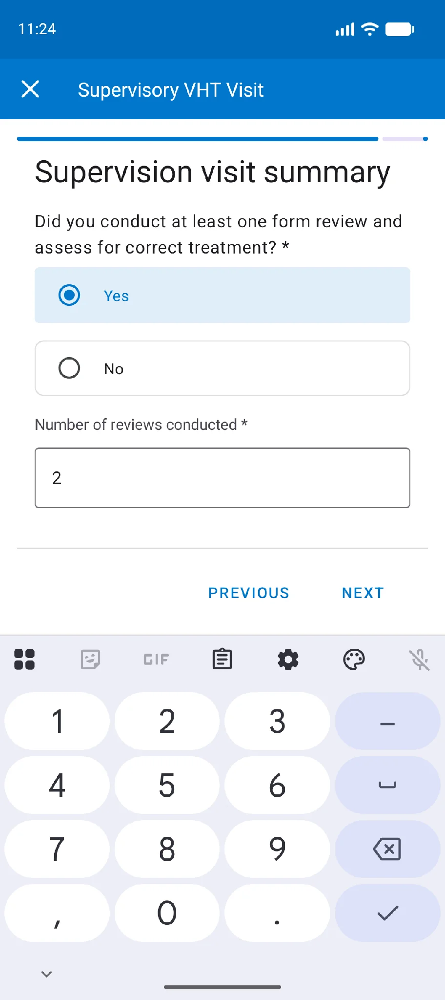

</Figure>

Submit the completed form with the button at the foot of the last page.

## Community event based surveillance

### Incoming signals

**CEBS Incoming Signals** lists signals raised for your review. Search by signal type, CHW name or status.

<Figure caption="CEBS incoming signals">

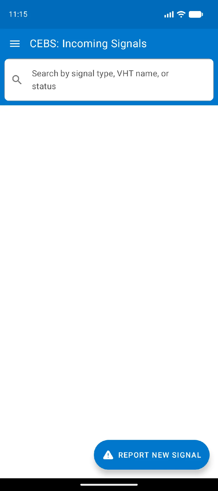

</Figure>

### Reporting a new signal

Tap **REPORT NEW SIGNAL** to raise one yourself. The form opens with a question about whether the household or community has experienced an unusual health event in the last 30 days, and it pre-fills your name, contact and village.

<Figure caption="Report new signal">

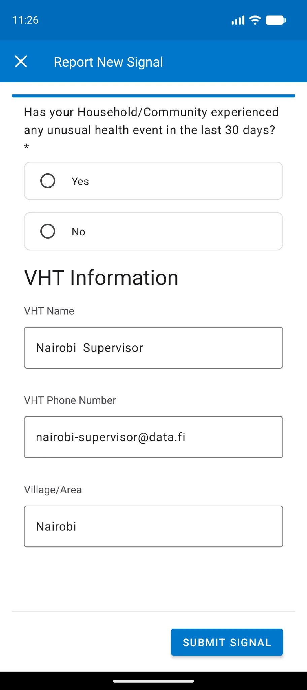

</Figure>

Answering yes reveals the signal types. You can report only one signal at a time.

<Figure caption="Signal types">

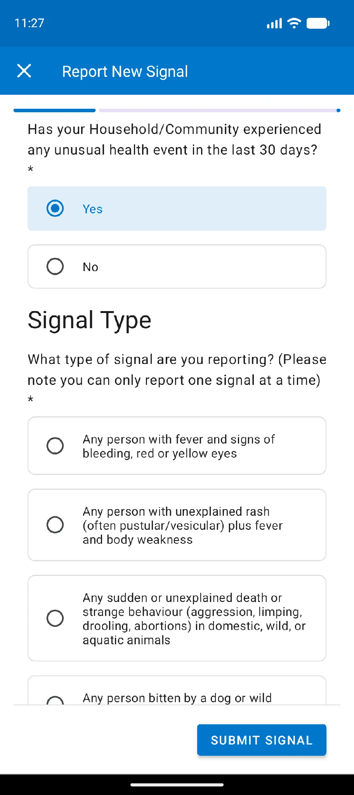

</Figure>

<Figure caption="Remaining signal types and the description field">

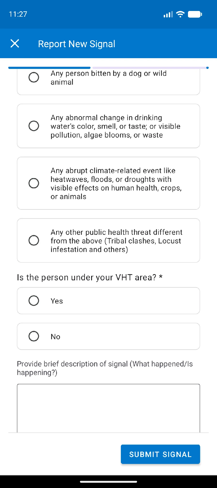

</Figure>

The form then asks whether the person is under your area and takes a brief description of what happened.

### CEBS history

**CEBS History** holds signals already handled. Search by village or status.

<Figure caption="CEBS history">

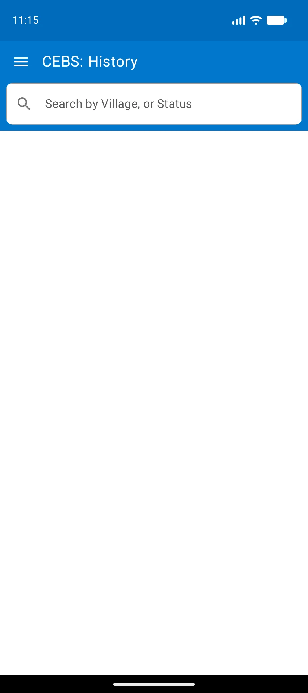

</Figure>

## Approval tasks

**Approval Tasks** lists items that need your approval. Search by task type, patient name or CHW name.

<Figure caption="Approval tasks">

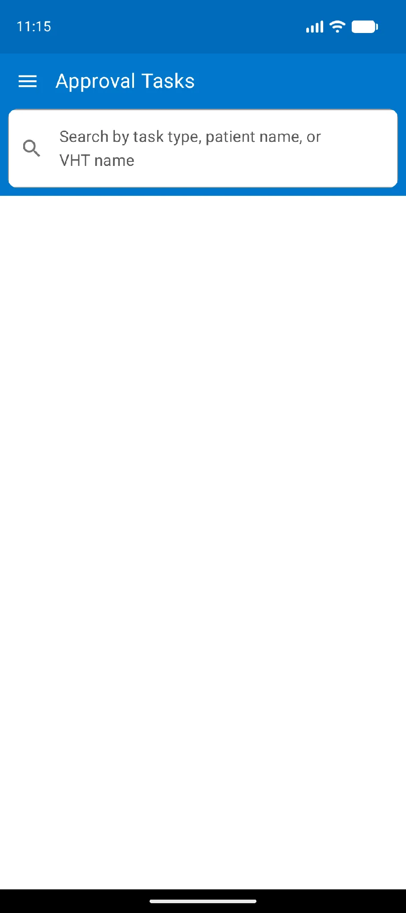

</Figure>

## Reports

**Reports** opens a period picker offering the full year or a single month.

<Figure caption="Selecting a reporting period">

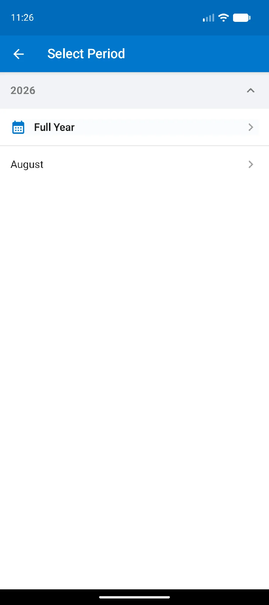

</Figure>

Choosing a period opens the report for it.

<Figure caption="A monthly report">

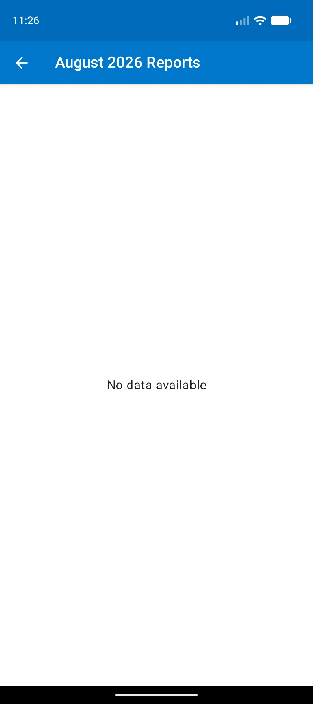

</Figure>

:::note

The reference environment held no reporting data, so the report reads "No data available".

:::

## Profile and settings

**Profile** shows your name, username and assigned location, along with the app version and the time of the last sync.

<Figure caption="Profile and settings">

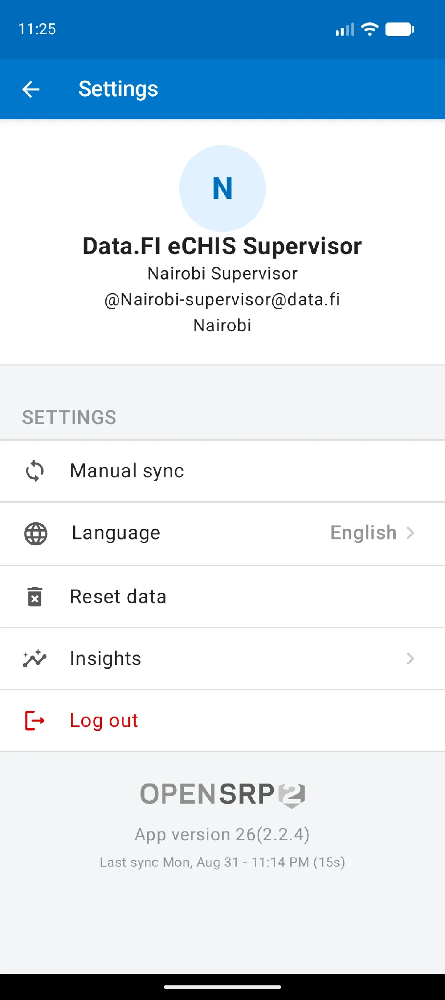

</Figure>

The settings available are the following.

- **Manual sync**, which syncs the device

- **Language**, set to English

- **Reset data**, which clears local data

- **Insights**, which reports on the state of the app

- **Log out**, which ends the session and returns to the login page

## Peer to peer data transfer

Peer to peer transfer is not in use. Earlier versions of this guide described moving data between a CHW device and a supervisor device over a direct connection, and that section no longer applies. The option is absent from the app, so the profile settings offer only manual sync, language, reset data, insights and log out, and no transfer entry point exists on the registers. Sync data through **Manual sync** instead, as described in [Syncing data](#syncing-data).
