import Figure from '@site/src/components/Figure';

During regular home visits a VHT may meet a woman who is pregnant, or who confides that she is pregnant. The woman is registered in the antenatal care (ANC) register and urged to visit the health facility if she has not already done so. Workflow overview: [Maternal and newborn continuity](../../workflows/maternal-newborn-continuity.md).

## Registering a pregnancy

Once a woman of reproductive age (16 to 49 years) is registered in a household, she can be enrolled in the ANC register by registering her pregnancy.

1. Open the All Households register and search for the woman's household. The household profile opens.
2. Tap the woman's name to open her profile.
3. Tap the menu in the top right corner.
4. Tap **Pregnancy Assessment**. The **Record to ANC** form opens.

<Figure caption="Opening ANC registration">

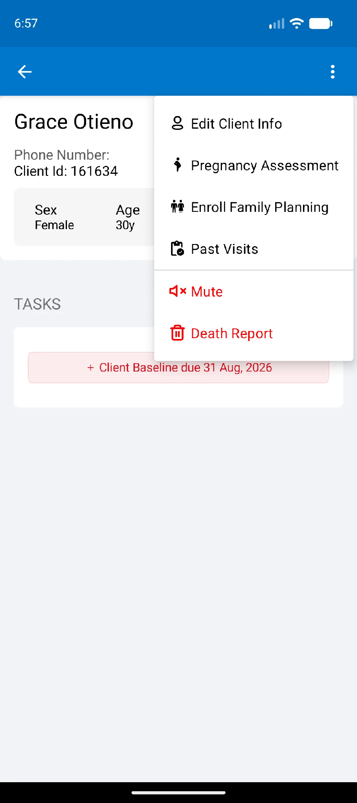

</Figure>

5. Fill in the required fields on the ANC registration form:

   - Was the pregnancy confirmed in a health facility. Answering yes asks for the name of the facility visited
   - Does the woman have an ANC card. If no, the client is not enrolled in ANC and a referral is prompted so she can get an ANC card
   - Does she know the start date of her last menstrual period. Answering yes asks for the start date of the last normal menstrual period (LNMP)
   - Gestational age in weeks, which the app computes from the LNMP and which cannot be edited
   - Expected date of delivery (EDD), which the app computes from the LNMP and which cannot be edited
   - How many antenatal care visits she has made so far in this pregnancy. Entering one or more asks for the date of the most recent ANC visit
   - Evaluation for danger signs. If a danger sign is selected, a referral to the health facility is prompted
   - HIV status check. This asks whether the woman knows her status, whether she has been tested in the last three months, and whether regular testing was reinforced

:::note

All fields except danger signs are required.

:::

<Figure caption="An open ANC registration form">

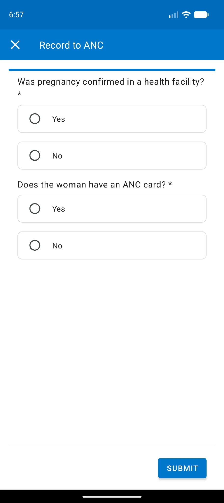

</Figure>

The form grows as you answer. Recording the LNMP fills in the gestational age and the expected date of delivery, neither of which can be edited.

<Figure caption="Gestational age and EDD computed from the LNMP, the danger signs evaluation, and the HIV status check">

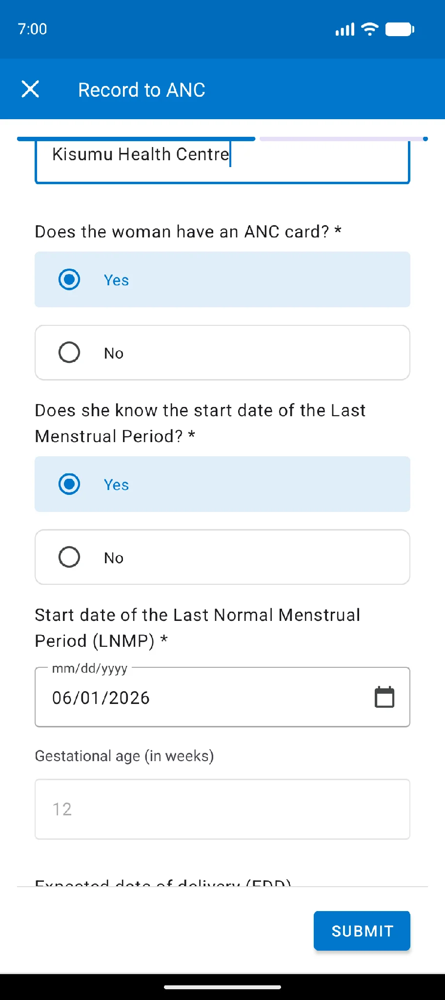

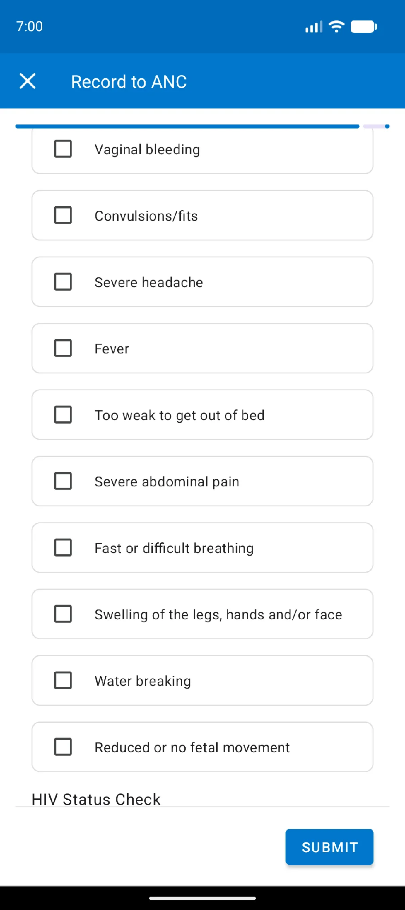

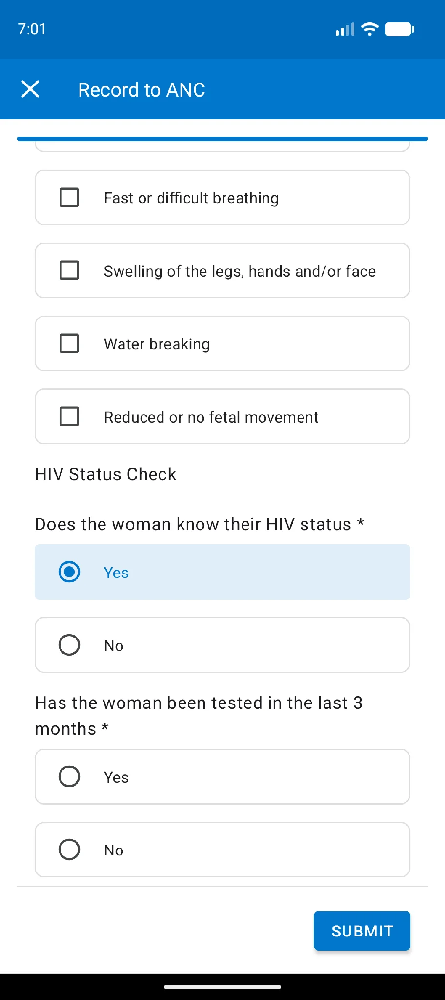

</Figure>

6. To complete the registration, tap **Save** in the top right corner. The woman and the information about her pregnancy are added to the **ANC** register, where she appears at the top.

<Figure caption="Newly registered ANC woman at the top of the ANC register">

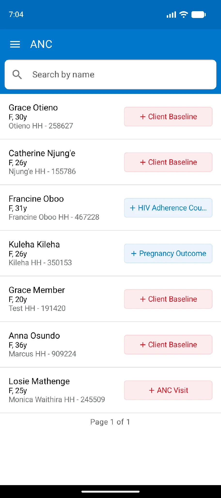

</Figure>

## The ANC client profile

Once a pregnancy is registered, the woman's profile appears in the ANC register.

1. Open the ANC register from the side menu. A newly registered pregnant woman is at the top.
2. Tap her name to open the ANC client profile.

<Figure caption="ANC client profile">

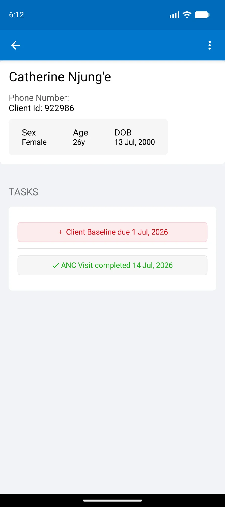

</Figure>

## Recording an ANC home visit

On the client profile you can see whether a visit is due (blue) or past due (red), and record the monthly home visit.

1. Open the ANC register and search for the woman you visited.
2. Tap her name to open her profile.
3. Tap the **Record ANC Visit** task (blue or red). The home visit form opens. It contains a set of tasks to record during the ANC visit. Some are scheduled for specific times in the pregnancy and some recur at every visit.

<Figure caption="The task that records ANC home visits, and the questions asked during the visit">

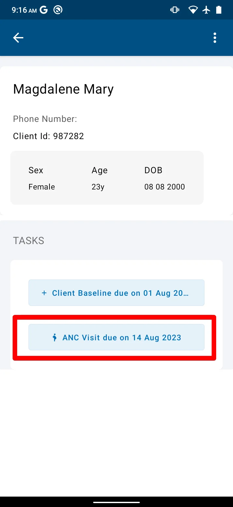

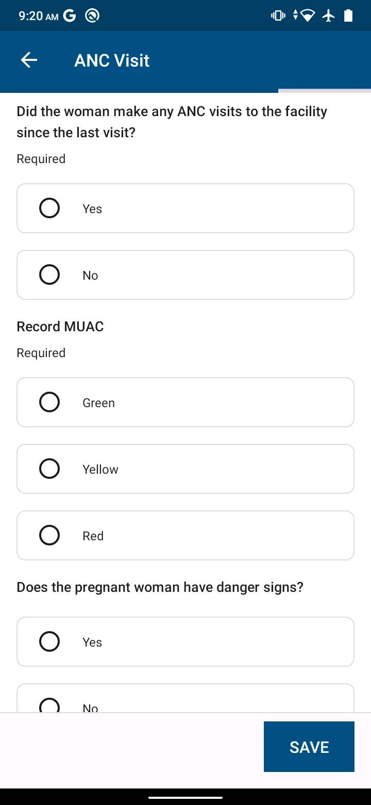

</Figure>

4. Fill in all the fields on the form:

   - Client made an ANC visit
   - Date of the previous ANC visit
   - MUAC reading. A red or yellow MUAC triggers a referral
   - Pregnancy risk or danger signs (optional). Danger signs trigger a referral
   - Date of the next ANC visit

5. Tap **Submit** at the top of the page. The record is saved and you return to the client's profile.

:::note

A completed task is marked with a green tick, which shows the record is saved on the device.

:::

After the visit the profile shows:

1. A **pregnancy referral closure** task, generated when a referral condition has been met: danger signs were identified, or a red or yellow MUAC was recorded
2. A green icon denoting a completed task
3. The next home visit task. In the example, the ANC visit is due on 1 September 2023

<Figure caption="Completed ANC home visit form">

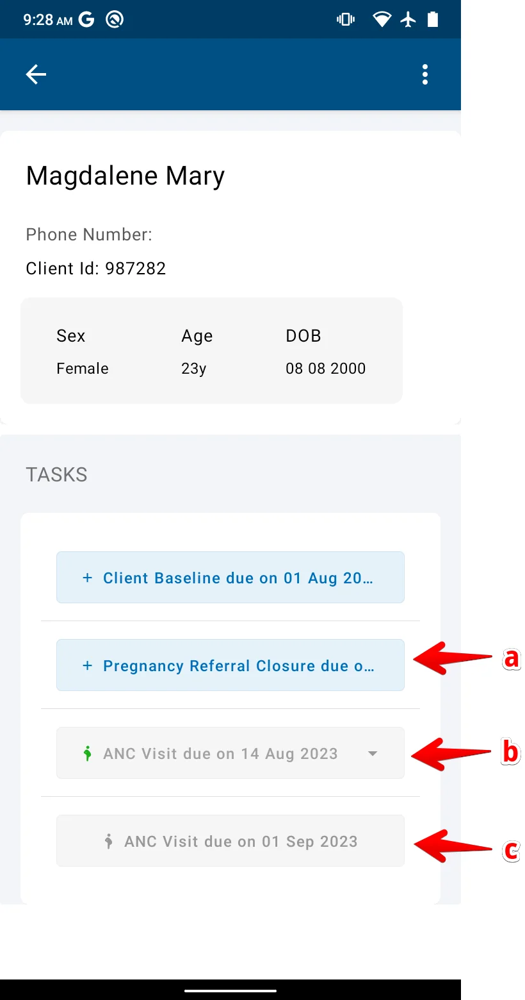

</Figure>

### How to fill the ANC home visit form

**Danger signs.** Review the list of danger signs the woman should be checked for at every ANC home visit. If any are present, record them and refer the woman immediately to a health facility. If none are present, counsel the woman on danger signs.

<Figure caption="ANC danger signs form, and the form with some danger signs selected">

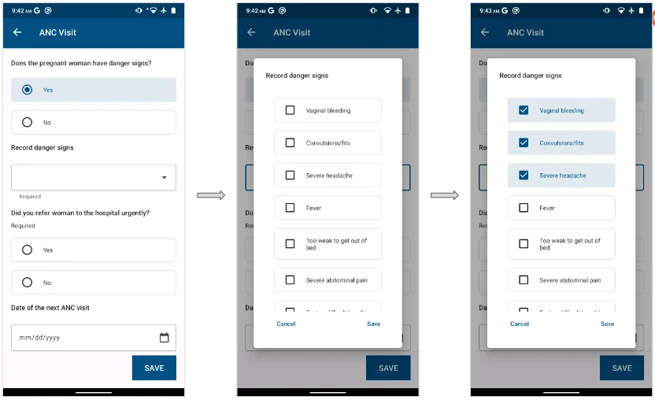

</Figure>

**ANC health facility visit.** A key part of the VHT role is to refer a woman to the health facility to receive her full clinical ANC visit. This section records whether the woman visited a health facility and the date of the visit.

<Figure caption="ANC health facility visit section">

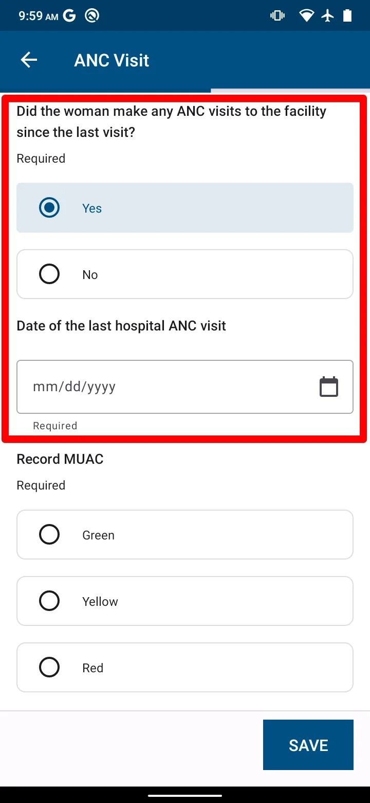

</Figure>

**Nutrition status.** Check the mother's nutritional status with MUAC to make sure she is eating enough and well, to prevent malnutrition and keep the baby growing healthily. Use the result to advise her during counselling.

<Figure caption="Nutritional status check">

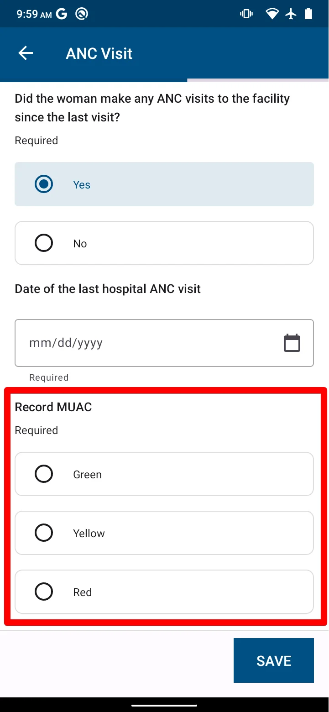

</Figure>

**ANC referral.** If a pregnant mother is unwell or shows danger signs, refer her to the health facility you are linked to through the referral system.

<Figure caption="Referral on the ANC home visit form">

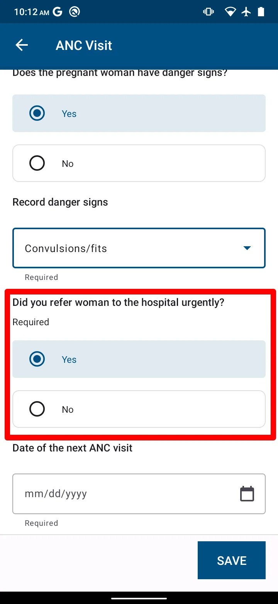

</Figure>

## Pregnancy referral closure task

When a pregnant mother is unwell or shows danger signs, you can send her to a health facility you are linked to through the referral system. Once a referral is confirmed, a referral closure task is generated. Complete it after the client has visited the health facility. Workflow overview: [Referral and counter-referral](../../workflows/referral-counter-referral.md).

1. Launch the referral closure task from the client profile.

<Figure caption="Referral closure task on the client profile">

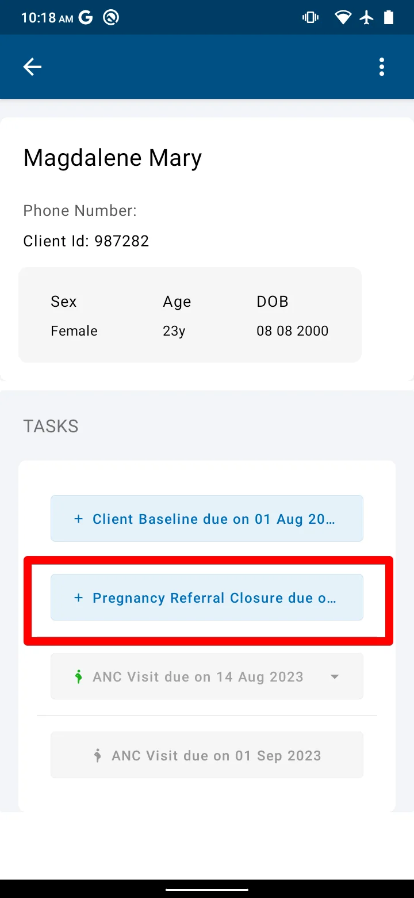

</Figure>

2. Fill in the required fields:

   - Confirm whether the client visited the health facility
   - Record the health facility visited
   - Record the actions taken: treated and sent home, admitted, or other
   - Confirm whether follow-up care is needed

<Figure caption="Referral closure form">

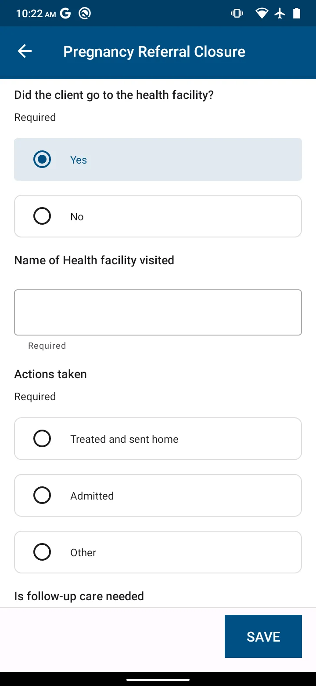

</Figure>

## Recording a pregnancy outcome

1. Open the ANC woman's profile.
2. Tap the menu in the top right corner. A list of options appears.

<Figure caption="Opening the pregnancy outcome form">

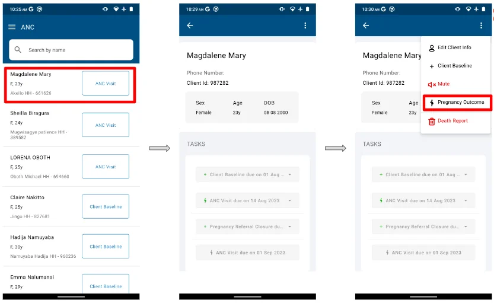

</Figure>

3. Tap **Pregnancy outcome**. The Pregnancy Outcome form opens.
4. Fill in the details of the pregnancy outcome, section by section.

**Outcome.** Select **Child was stillborn** or **Child was born alive**, then enter the delivery date and where the mother gave birth.

<Figure caption="Pregnancy outcomes for a child born alive, born alive but died, or stillborn">

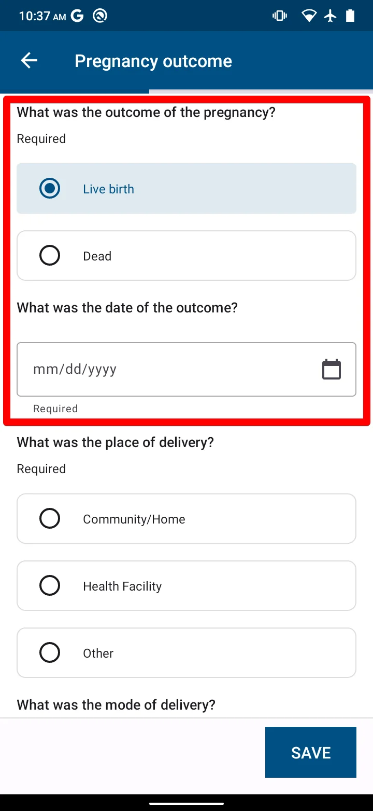

</Figure>

**Place of delivery.** A home delivery prompts a referral to a health facility.

<Figure caption="Place of delivery">

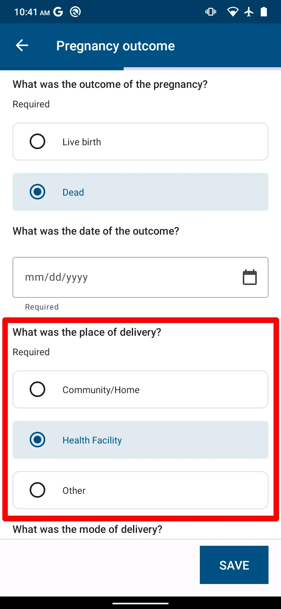

</Figure>

**Mode of delivery, provider of the service and number of children born.**

:::note

If more than one child was born, a birth registration form must be filled for each child.

:::

<Figure caption="Recording mode of delivery, provider and number of children born">

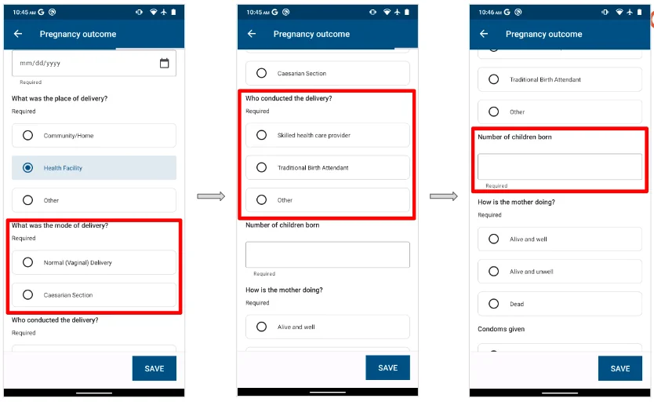

</Figure>

**Mother and child danger signs.** Child danger signs are evaluated when there was a live birth.

<Figure caption="Evaluating a mother and child for danger signs">

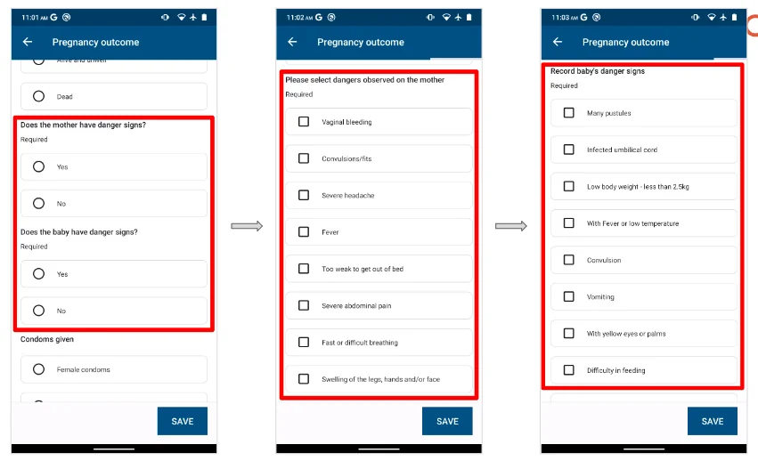

</Figure>

For a child born alive, the pregnancy outcome page asks for further details:

1. The pregnancy outcome: child was born alive, or child was born alive but has a problem
2. The delivery date
3. The place the mother gave birth, with details for that selection
4. Baby details: the number of children born alive

**Commodity issuance.** Any family planning commodities issued during the visit can be recorded here. The consumption details are updated automatically. See [Stock management](./stock-management.mdx).

<Figure caption="Commodity issuance">

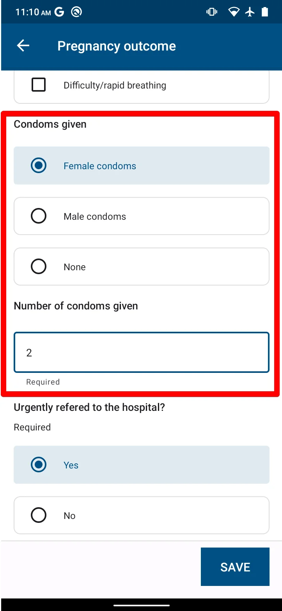

</Figure>

**Referral.** A referral question is enabled if any of the following apply:

1. The place of delivery is recorded as in the community
2. The delivery was conducted by a traditional birth attendant
3. The mother has danger signs
4. The newborn has danger signs

<Figure caption="Referral on the pregnancy outcome form">

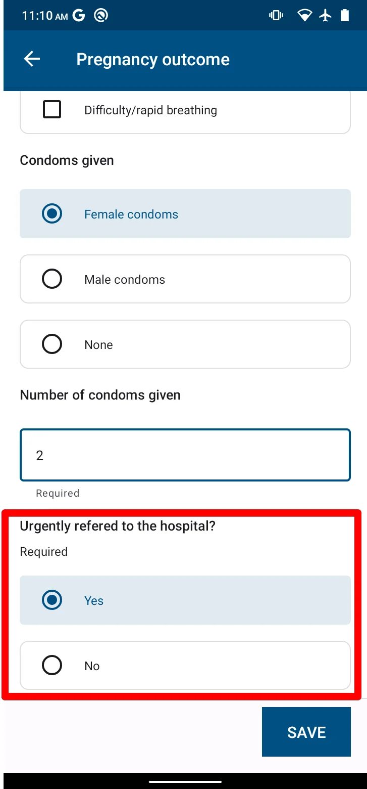

</Figure>

5. Once the details are recorded, tap **SAVE**. The birth outcome is saved and the mother moves from the ANC register to the PNC register. See [Postnatal care](./postnatal-care.mdx).

:::note

All newborns have to be added to the household as individual household members. See [Registering a household member](./households.mdx#registering-a-household-member).

:::

<Figure caption="A newly recorded pregnancy outcome in the PNC register, and the new mother's profile with her child">

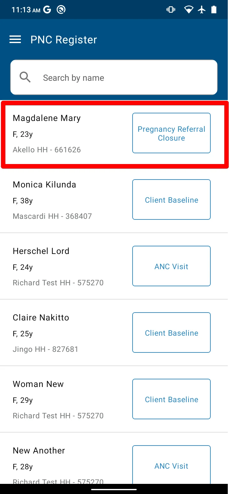

</Figure>
