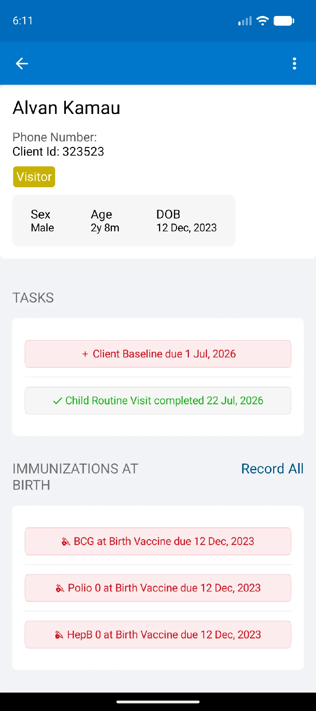
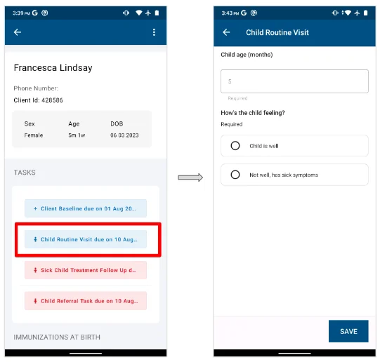
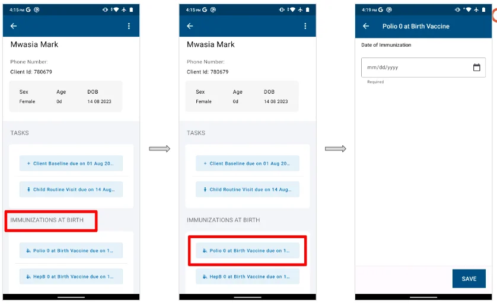
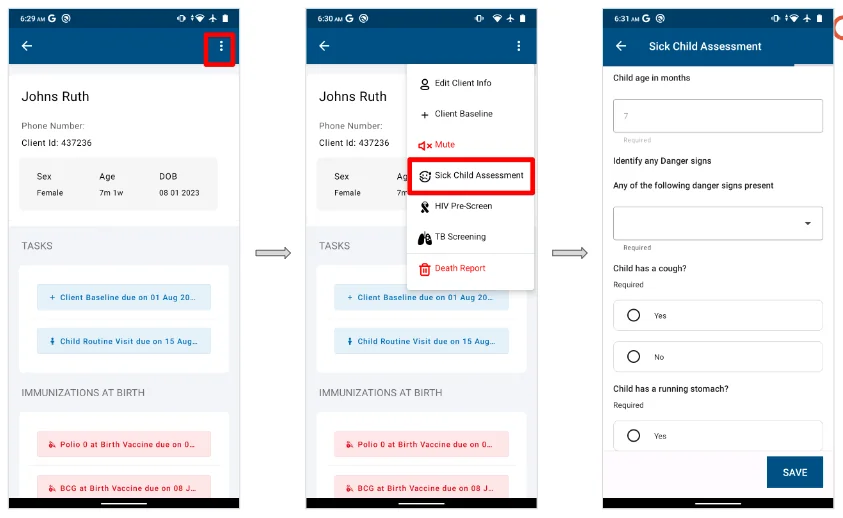
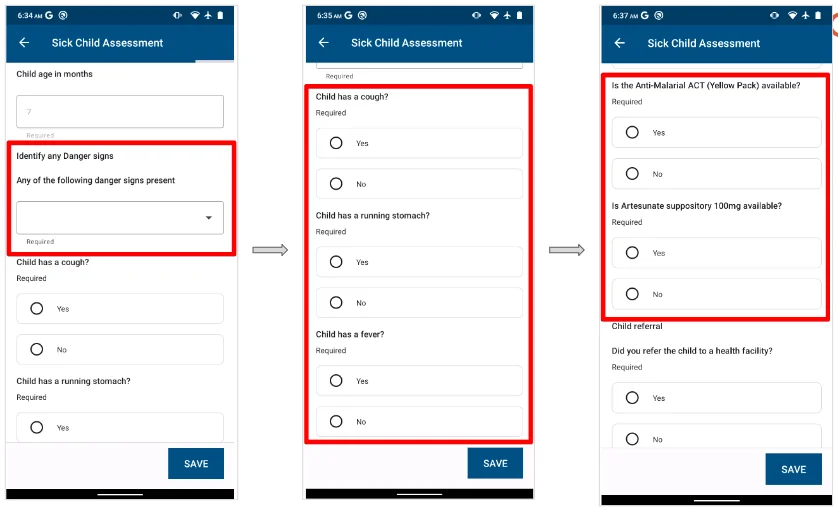
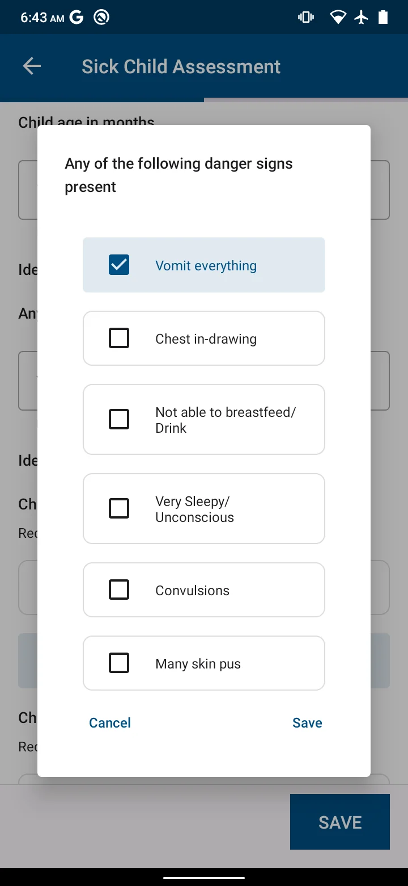
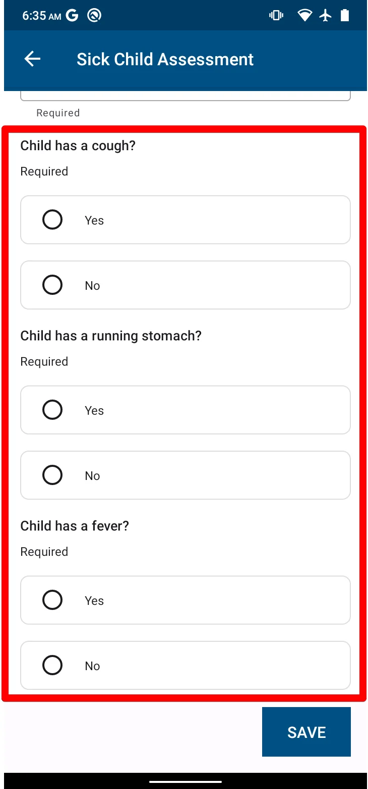

import Figure from '@site/src/components/Figure';

The **Children** register is a record of all children under five years (59 months). Each child's record holds immunization data, nutrition tracking, upcoming services and VHT tasks. Workflow overview: [Child health and immunization](../../workflows/child-health-immunization.md).

## Registering a child

In the app, a child is any person aged 0 to 5 years. Children are registered when registering household members in the **All Households** register. See [Registering a household member](./households.mdx#registering-a-household-member).

## The child profile

The child profile differs from other profiles in that it shows the child's immunization requirements.

1. Open the Children register. Search for the child, or scroll to the child's name, and tap it. The child's profile opens.
2. The profile shows:

   - An icon of a child
   - The child's name and age
   - Gender, location and unique ID
   - Tasks
   - The immunizations view

3. To leave the profile, tap the device back button.

<Figure caption="Child profile for a child with due services">

</Figure>

## Recording a child's routine visit

A VHT visits each child at home every month and completes a set of child-focused tasks. Some are scheduled and others recur:

| Service | Scheduled or recurring |
|---|---|
| Recording immunizations received | Schedule-based |
| Recording Vitamin A supplementation received | Schedule-based, 6 to 59 months |
| Recording deworming received | Schedule-based, 12 to 59 months |

A child routine visit can only be recorded when it is due or overdue.

1. Open the child's profile through the Children register or the All Households register.
2. Tap the **Child Routine Visit** task. The routine visit form opens, showing the child's age.

<Figure caption="Recording a child home visit">

</Figure>

3. Fill in the form (see [How to fill the child routine visit form](#how-to-fill-the-child-routine-visit-form)):

   - Vitamin A and deworming, for children over six months
   - Vaccine card
   - Nutrition status

4. Tap **SUBMIT** once all the required fields are completed.

### How to fill the child routine visit form

1. **Child's age.** Calculated from the child's date of birth. This field cannot be edited.
2. **How the child is feeling.** Record this from your own assessment. If the child is not well, the form recommends a sick child assessment. If the child is well, the rest of the form can be completed.
3. **Vaccine card received.** Confirm whether the child has a vaccine card.
4. **Immunization status.** Confirm whether the child's immunizations are up to date. If not, a referral for the recommended antigens is recommended.
5. **MUAC assessment.** Take the MUAC reading. A red or yellow MUAC requires a referral.
6. **Oedema.** Assess the child for swelling. If swelling is present, a referral is recommended.
7. **Vitamin A.** Only available for children over six months. Record yes if Vitamin A was given.
8. **Deworming.** Only available for children over 12 months. Record yes if a deworming tablet was given.

## Recording an immunization

The immunization card is only available for children under five years.

The vaccines recorded during a child home visit are BCG, OPV 0 to 3, Penta 1 to 3, Rota 1 to 3, IPV and MR 1 to 2. They follow WHO guidelines and the national immunization schedule, and are given at different stages of the child's development.

1. From the child's profile, go to the vaccine listed and tap it to open **Record vaccinations**.
2. Tick the vaccines given to the child and enter the dates they were given.

<Figure caption="Recording vaccines from the same group given at the same time">

</Figure>

## Recording a sick child

When a VHT meets a sick child, they can fill in a sick child form. The form is based on the WHO Integrated Management of Childhood Illness (IMCI) and is available for children. **A sick child under two months must be urgently referred to a health facility.** The form records what the child is suffering from, the possible diagnosis based on the symptoms and tests, and the treatments available. When a child is very sick, the VHT should refer them urgently to the nearest health facility by filling in the sick child form.

1. Open the sick child's profile through the household or Children register.
2. Tap the menu in the top right corner.
3. Select **Sick Assessment**. The sick child form opens.

<Figure caption="Opening the sick child form">

</Figure>

A sick child form has four parts:

- A danger signs check
- A main symptoms check
- Pre-referral treatment
- Child referral

<Figure caption="Danger signs check, general symptoms and pre-referral treatment">

</Figure>

:::note

The sick child form is based on the World Health Organization Integrated Management of Childhood Illness chart booklet (2014).[^1]

:::

### Danger signs check

When you open the sick child form, record any signs the caregiver has observed. Ask the caregiver whether they have noticed any of the following and select all that apply:

- Child is not able to drink or breastfeed
- Child is vomiting everything
- Child has had convulsions
- Child is lethargic or unconscious
- Child is convulsing now
- Chest in-drawing
- Yellow eyes or hands
- Blood in stool

If the child has any of these signs, refer them to hospital urgently. Quickly fill in the rest of the form and send the caregiver and child to a health facility immediately. If the child has none of these signs, select **None** and proceed to the main symptoms check.

<Figure caption="Danger signs check">

</Figure>

### Symptoms check

The symptoms check looks in detail at the symptoms the child is experiencing. The information given or observed leads to a diagnosis, treatment and/or referral depending on the child's condition. Check these three key symptoms and fill in each:

- Cough or difficulty breathing
- Diarrhoea
- Fever

:::note

1. Refer all severe diagnoses to hospital urgently.
2. A child can have more than one symptom at a time. Check all the symptoms the child is suffering from.

:::

<Figure caption="Main symptoms check after the general danger signs">

</Figure>

Once the symptom checks are done, complete the sick child form by confirming whether pre-referral treatment was given. Save and submit the form.

:::tip

If a child needs to be referred to a health facility, a referral confirmation question appears at the bottom of the form.

:::

[^1]: [WHO IMCI chart booklet](https://www.who.int/maternal_child_adolescent/documents/IMCI_chartbooklet/en/)
