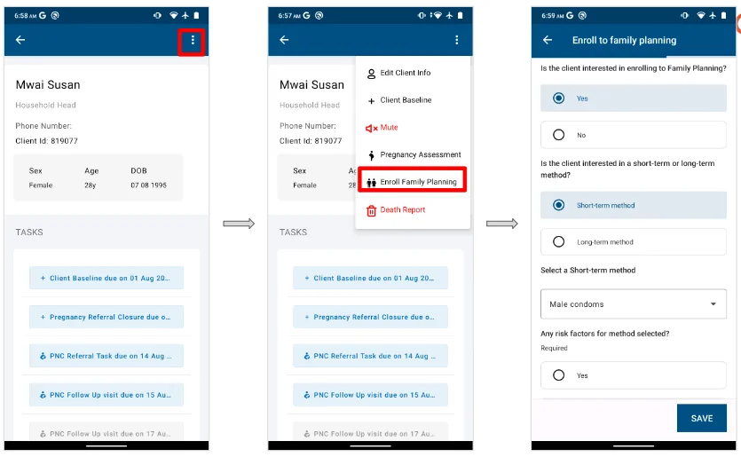
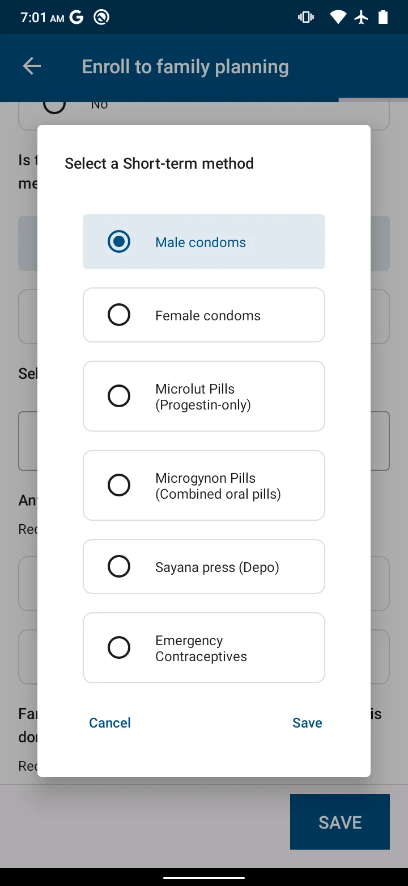
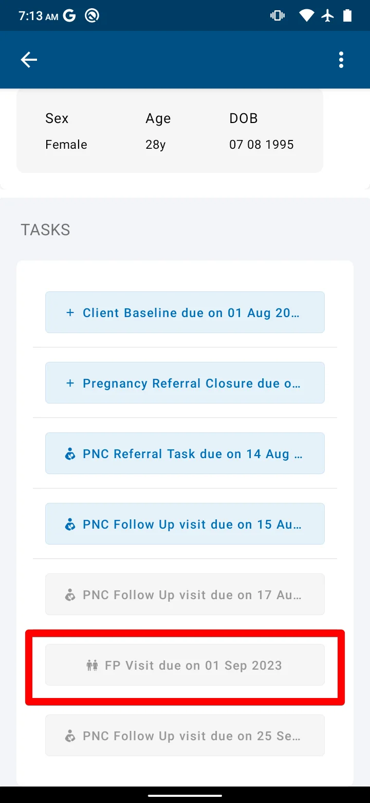

import Figure from '@site/src/components/Figure';

Once a woman reaches reproductive age and is not pregnant, she can take up a family planning (FP) method. A man of reproductive age can also take up a suitable method. All clients who have taken up, or plan to take up, an FP method are placed in the FP register. To appear in the register, the client must first be registered in a household. Workflow overview: [Family planning](../../workflows/family-planning.md).

## Registering a family planning client

A woman can be registered for FP from the PNC register or the All Households register. A man is registered from the All Households register. Clients must have reached reproductive age (12 to 49 years).

1. Open the client's profile from the All Households register.
2. Tap the menu in the top right corner of the profile and select **FP initiation**. The FP registration form opens.

<Figure caption="Opening the FP registration form">

</Figure>

3. Fill in the form:

   - Confirm whether the client is interested in using an FP method
   - Select the method chosen from the list of FP methods and fill in its details, as described in step 5

<Figure caption="Family planning registration and selecting an FP method">

</Figure>

4. Record whether the client was counselled on the different FP methods and on HIV and STI prevention.
5. Fill in the details for the method the client chose:

   - **Male or female condoms.** Record the number of condoms given, whether the client was counselled on how to use the method, and whether the client was referred to the health facility.
   - **COC or POP.** Record the pill cycles given, whether the client was counselled on how to use the method, and whether the client was referred to the health facility.
   - **Standard days method.** Record whether the client was counselled on how to use the method, and whether the client was referred to the health facility.
   - **Emergency pill.** Counsel the client to choose a spacing or permanent FP method. Record whether the client was counselled on how to use the method, and whether the client was referred to the health facility.
   - **Injection.** Record whether the client was referred to the health facility.

6. Tap **SUBMIT** to save the record.
7. Once the FP registration is complete, the client appears in the FP register.

## Recording a family planning visit

Home visits for a family planning client are scheduled every three months. Open the client from the FP register and launch the visit task shown against them.

<Figure caption="FP client profile with the visit task">

</Figure>

## FP client referral

An FP client may need a referral to the health facility for reasons such as:

- The client is on a long-term method
- Serious side effects that need medical attention
- Commodities are not available to issue

Workflow overview: [Referral and counter-referral](../../workflows/referral-counter-referral.md).
