import Figure from '@site/src/components/Figure';

## Opening the app from the device

If the app has already been installed on the device, look for the **MoH eCHIS** app on the applications page.

<Figure caption="Home screen on an Android device">

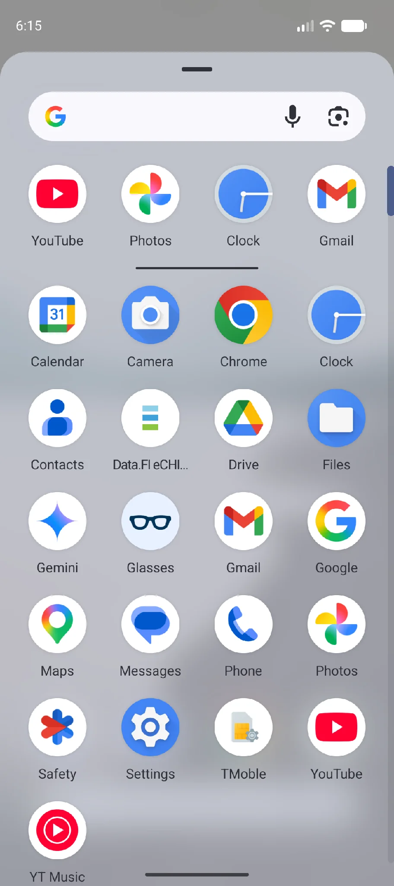

</Figure>

## Logging into the application

To log into the app you need an application ID, a username and a password. The support team provides these. Once provided, they are unique to you. If you are a VHT, your username and password are unique to you. **Do not share** your login details with anyone else. If you forget your username or password, contact the support team right away so that they can help you log back into the app.

| Item | Provided by |
|---|---|
| Application ID | Support team |
| Username | Support team |
| Password | Support team |
| PIN | Set by the VHT |

On a device where the app has not been set up before, the first screen asks for the application ID. Enter the ID given to you by the support team and tap **LOAD CONFIGURATIONS**. The app then downloads its configuration and shows the login screen.

<Figure caption="Application ID screen shown on first run, and the login screen">

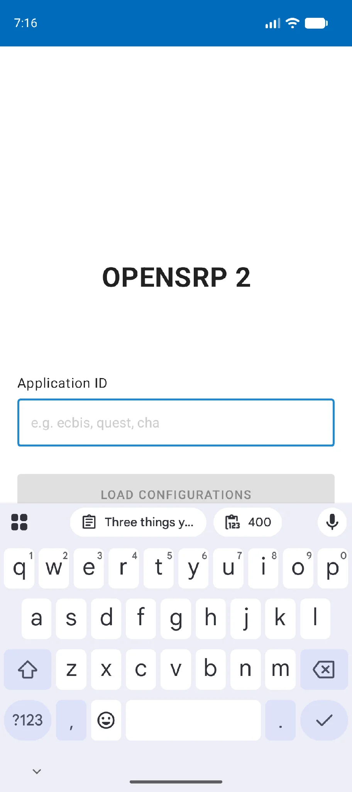

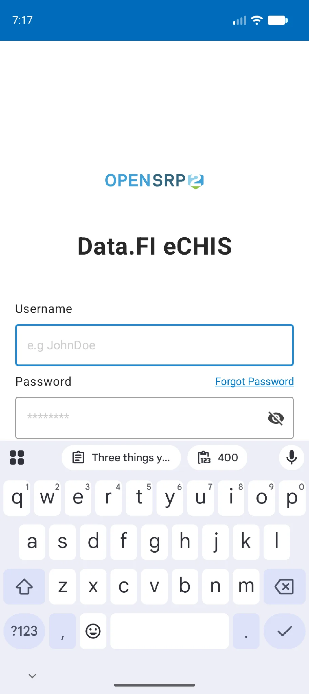

</Figure>

After the first successful login, the app asks you to choose a four-digit PIN.

<Figure caption="Set PIN screen shown after the first login">

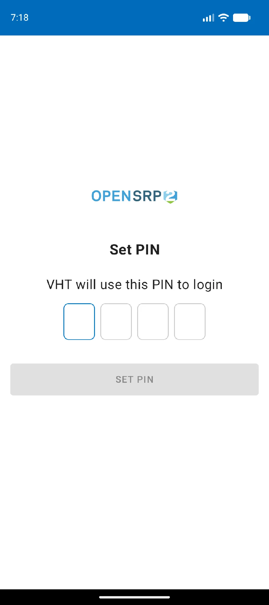

</Figure>

Once a PIN has been set, later logins on the same device ask for the PIN instead of the username and password.

<Figure caption="PIN login screen for a returning user">

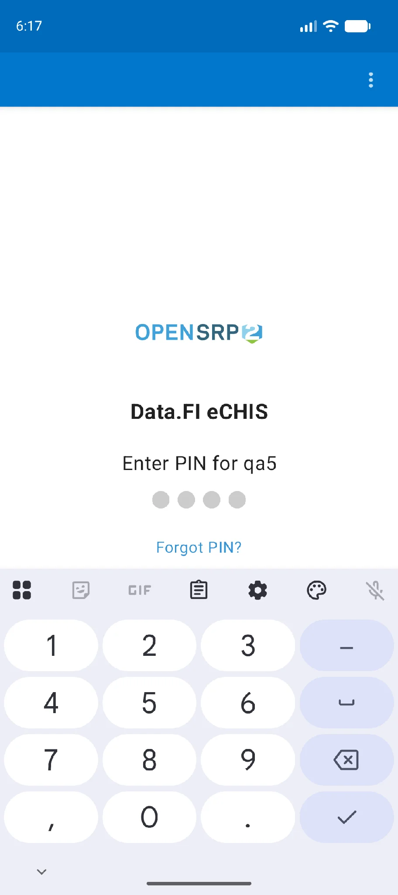

</Figure>

To open the app, tap the **MoH eCHIS** icon on your home page or in your device's app menu.

:::note

The device **must** be connected to the internet for the first login. If the device was used by another VHT previously, clear the app's existing data to allow login with new credentials.

:::

## Initial sync

The first time you log in, let the sync finish so that all forms and data load onto the device. Once it finishes you can disconnect from the internet and the app keeps working.

<Figure caption="Initial sync in progress">

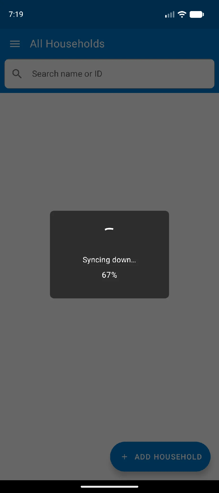

</Figure>

## Logging out of the application

To make sure no data is lost or entered by mistake, always log out of the app when it is not in use. To log out:

1. Open the [side menu](#the-side-menu).
2. Tap **Profile** at the bottom of the side menu.
3. On the profile screen, tap **Log out**.
4. This logs you out of the application and closes it, returning the device to its home screen.

:::note

Logging out ends the session on the server. The next login asks for the username and password again rather than the PIN.

:::

<Figure caption="Logging out of the app">

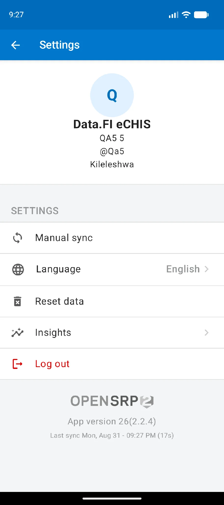

</Figure>

## The side menu

Once you are logged in, the **All Households** register is displayed. This doubles as the home page of the app. To open the side menu, tap the navigation icon in the top left corner.

The side menu includes:

1. The list of registers in the app, their icons and the number of clients in each register
2. The **Profile** menu
3. The **Sync** button

<Figure caption="Side menu">

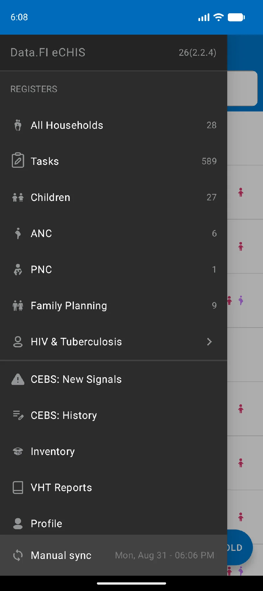

</Figure>

### The registers

The side menu lets you switch between registers. It also shows a count of the clients in each register. The register currently being viewed is highlighted in blue. See [The registers](./registers.mdx) for what each one holds.

### Syncing data

To get up-to-date data from the server, or to upload collected data from the device to the server, you need to synchronize (sync). On the side menu, scroll down to the **sync** option at the bottom left and tap it.

:::note

To sync data, the device **must** be connected to the internet.

:::

<Figure caption="Syncing app data">

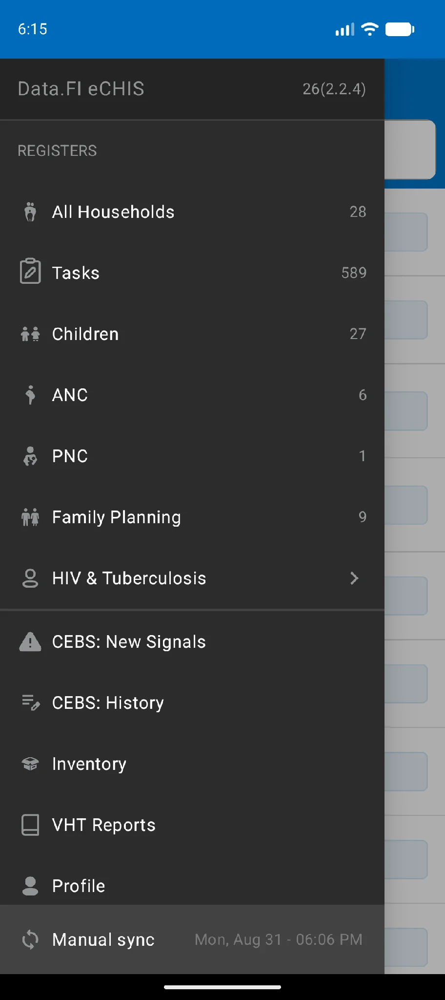

</Figure>

## The Add Household button

The **Add Household** button is at the bottom right of the **All Households** register. Tapping it opens the Add Household form, which registers a household. See [Adding a household](./households.mdx#adding-a-household).

<Figure caption="The Add Household button">

</Figure>

## Finding a client with the search bar

The search bar is at the top of every register. To search for a client, type their name or ID. In the **All Households** register you can also search by household name. There the household the member belongs to is displayed, whereas in the other registers the person's name is displayed.

<Figure caption="Searching by household name and by household ID in the All Households register">

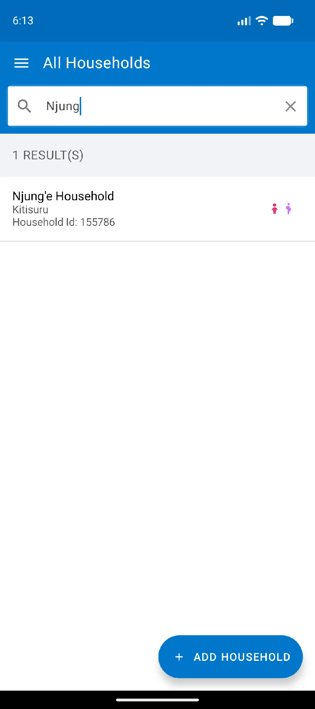

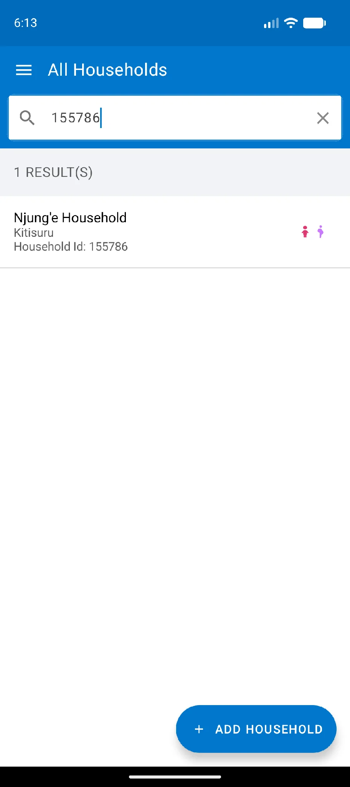

</Figure>

<Figure caption="Searching other registers by client name and by client ID">

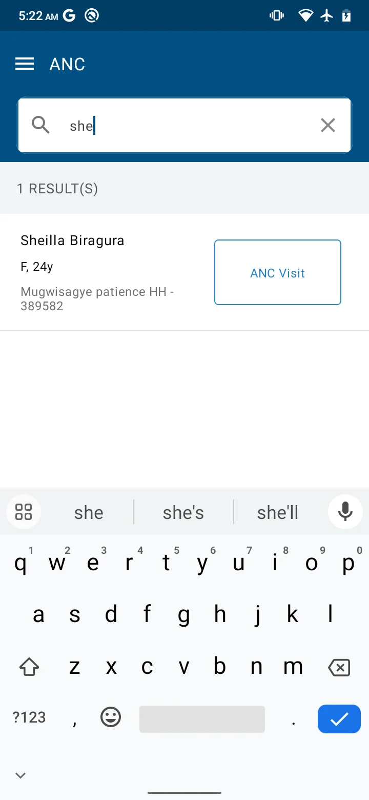

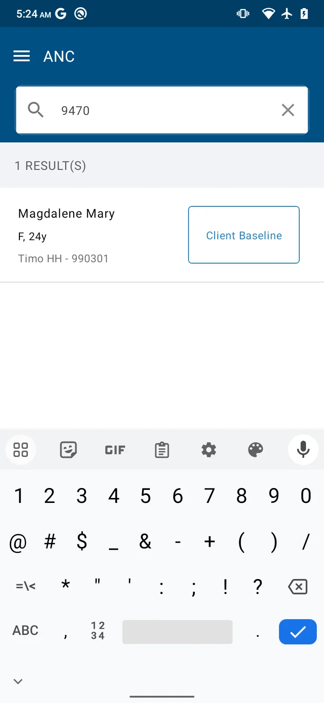

</Figure>
