import Figure from '@site/src/components/Figure';

This chapter covers the **All Households** register: registering a household, adding members, changing the household head, and viewing client data. Workflow overview: [Registration and household enrollment](../../workflows/registration-household-enrollment.md).

## Adding a household

Creating a household is the first step in the app. To add a client, their household must be registered first.

1. Tap the **Add Household** button at the bottom right of the **All Households** register.

<Figure caption="Add Household button">

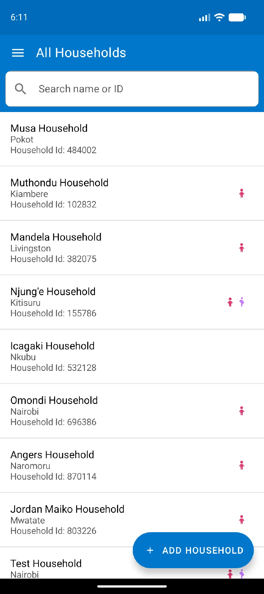

</Figure>

2. The **Add Household** form opens. It also carries a location widget with a **RECORD GPS LOCATION** button and latitude and longitude fields. Enter the household name and the village. The household ID is generated by the app and needs no action. Once these are filled, tap **SAVE**.

<Figure caption="Filling in household details on the registration form">

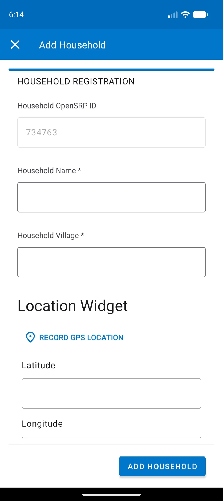

</Figure>

3. Once the household is created you return to the All Households page. The newly registered household appears at the top of the register. Members can now be added to it.

<Figure caption="A newly registered household">

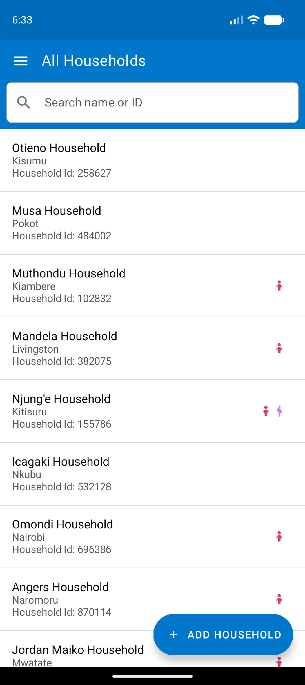

</Figure>

## Registering a household member

A new household member can only be registered to an existing household, so [add the household](#adding-a-household) first.

1. On the All Households register, tap the household the client belongs to, for example the Akello household.

<Figure caption="Selecting a household from the All Households register">

</Figure>

2. The household profile opens with the details of the household members.

<Figure caption="Household profile">

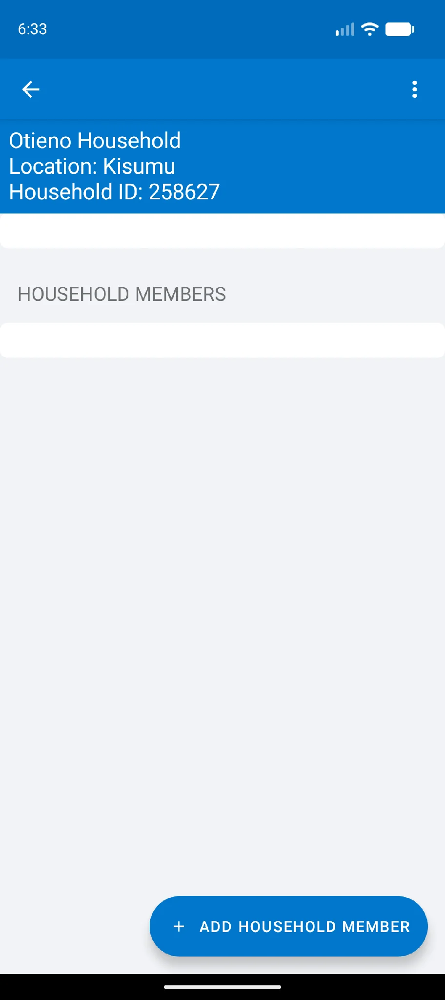

</Figure>

3. Tap **Add Household Member** at the bottom right of the screen.
4. The **Add household member** form opens.

<Figure caption="Add household member form: the empty form, the upper fields completed, and the client category, phone number and household head fields">

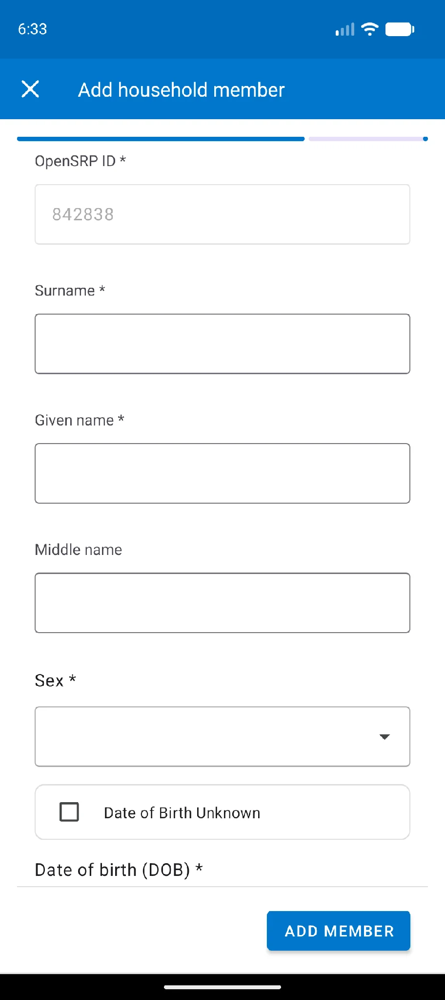

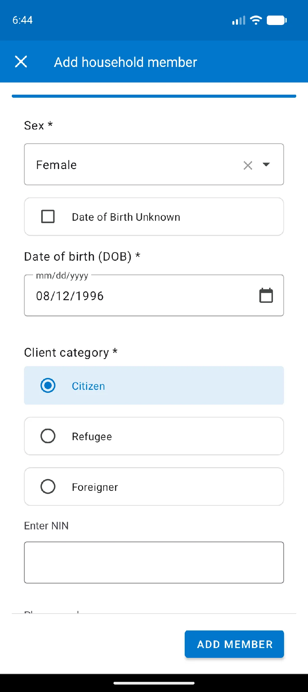

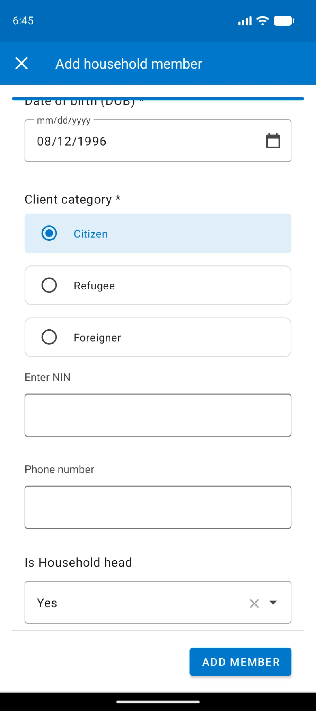

</Figure>

5. Fill in the required details and tap **SAVE**:

   - OpenSRP ID, which the app generates and which needs no action
   - Surname, which can be the same as the household name
   - Given name
   - Middle name
   - Sex
   - Date of birth. Tick **Date of Birth Unknown** to record an age in years and months instead
   - Client category: Citizen, Refugee or Foreigner
   - NIN
   - Phone number
   - Is household head
   - Is visitor, which is required

## The household profile

### Viewing the household profile

Once a household has been registered, its profile is reached from the All Households register.

1. Open the **All Households** register.

<Figure caption="All Households register">

</Figure>

2. Tap a household name. To find a specific household, type its name in the search bar. All households with that name are listed. Tap the correct one.

<Figure caption="Selecting a household from the All Households register">

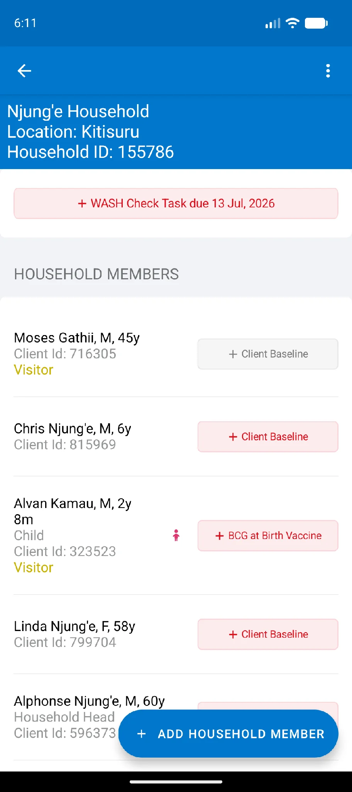

</Figure>

3. The household profile opens. It contains:

   - The household name, at the top
   - The location or village
   - The household ID
   - A list of all household members, identifying the household head
   - The age of each member next to their name, and their gender beneath it

### Changing household details

From time to time you will need to change a household's particulars, either the household details or the household head.

1. Open a household from the **All Households** register. The **household profile** opens.
2. Tap the menu in the top right corner. It lists the items that can be edited.

<Figure caption="Opening the household menu">

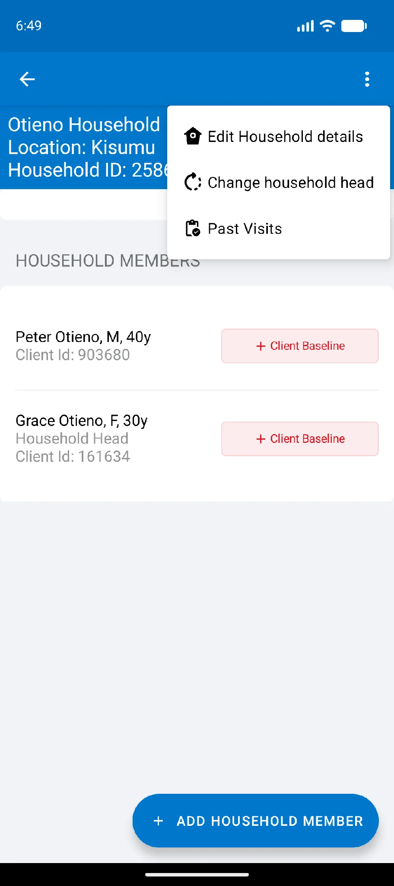

</Figure>

3. Tap **Edit Household details**. An editable form with the household details opens.

<Figure caption="Edit household details form">

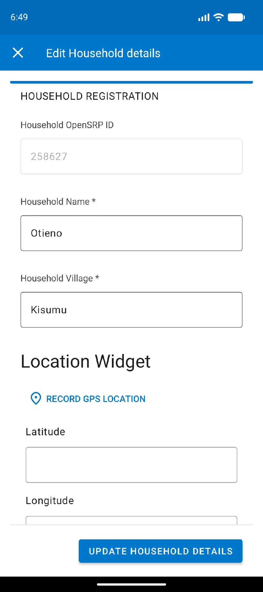

</Figure>

4. Tap the field that needs to change (household name, village or town) and make the change.

<Figure caption="Changing a household detail">

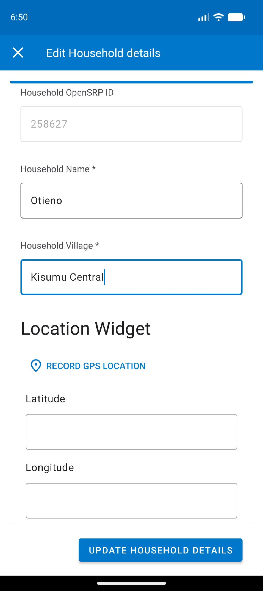

</Figure>

5. Tap **SAVE** at the bottom right to keep the changes. You return to the household page.

### Changing the household head

Each household has a household head, and the role can be moved between household members.

1. Open a **household profile** from the **All Households** register.
2. Tap the menu in the top right corner (three vertical dots).
3. Select **Change household head**. The **Change household head** form opens, listing all members who qualify to be household head.

<Figure caption="Change household head form">

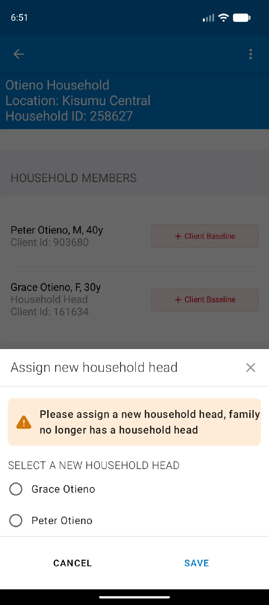

</Figure>

4. Select the member to be assigned as household head.

<Figure caption="Changing the household head">

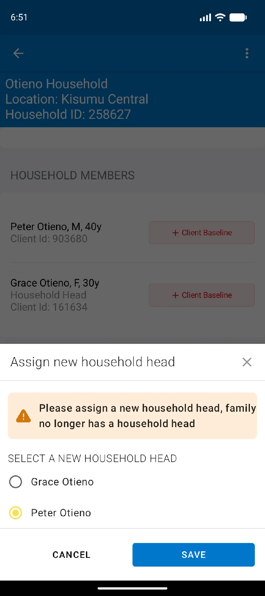

</Figure>

5. Tap **SAVE**. You return to the household profile, where the new household head has the **Household Head** role beneath their name.

## Managing household members

Sometimes a household member needs to be removed or muted, for example because of a death, moving away from the household, or another reason.

:::warning

Once a household member has been removed from the register, this cannot be undone. Make sure you really want to remove the member before proceeding.

:::

### Recording a death of a household member

Workflow overview: [Death reporting](../../workflows/death-reporting.md).

1. Open the household of the member through the All Households register.

<Figure caption="Household profile">

</Figure>

2. On the household profile, select the household member. Their profile opens.

<Figure caption="Household member profile">

</Figure>

3. Tap the menu in the top right corner (three vertical dots).

<Figure caption="Selecting the death report option">

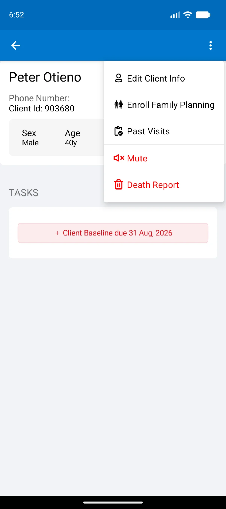

</Figure>

4. Tap **Death report**. The **Remove Member** form opens.

<Figure caption="Remove Member form">

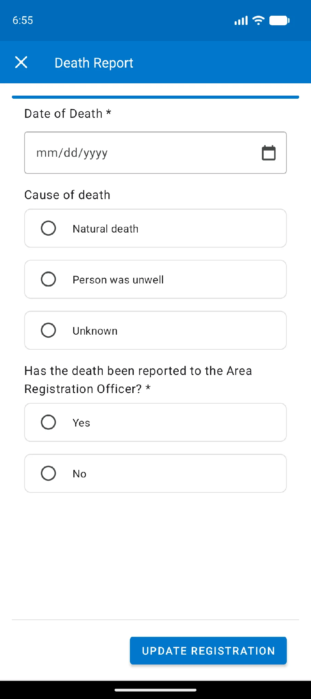

</Figure>

5. Fill in the details and tap **SAVE**.

<Figure caption="Completed death report">

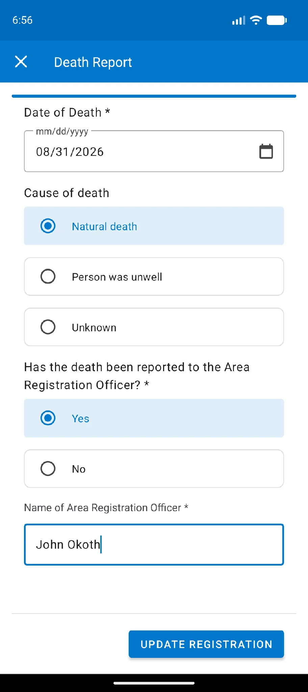

</Figure>

6. A message asks you to confirm the removal. It names the member and warns that the action cannot be undone. To remove the person, tap **REMOVE**. Tap **NO** to go back without recording anything.

<Figure caption="Confirming the death report">

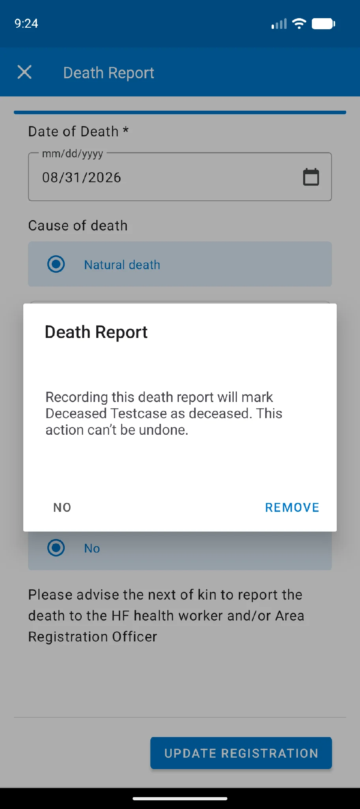

</Figure>

7. The app returns to the household profile. The member is marked **Deceased** and their tasks are withdrawn.

<Figure caption="Household profile after a member is removed">

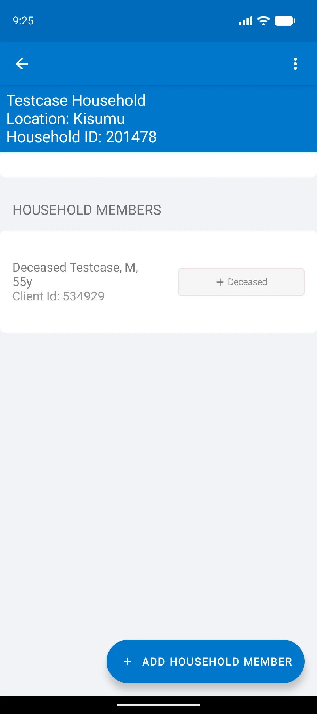

</Figure>

:::note

If a household member was removed because of a death, their name still appears on the household register but greyed out.

:::

### Muting a household member

1. Open the household of the member through the All Households register, then tap the household member.
2. On the member profile, tap the menu in the top right corner (three vertical dots).
3. Tap **Mute**. The mute form opens.

<Figure caption="Mute form">

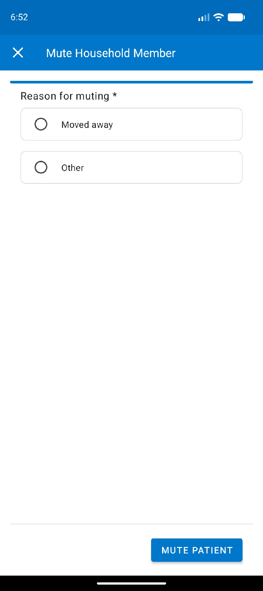

</Figure>

4. Select the reason for muting from the drop-down menu, fill in the details and tap **SAVE**.

<Figure caption="Confirming muting">

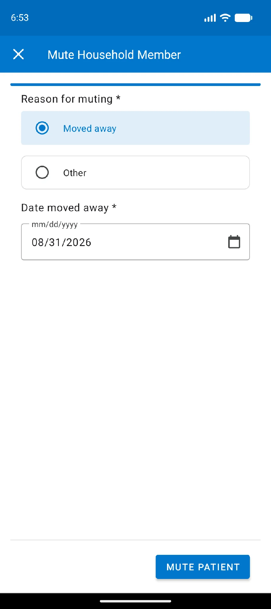

</Figure>

:::note

When a household member is muted, their name still appears on the household register and is marked **Muted**, as shown below. All their tasks are deactivated.

:::

<Figure caption="A muted household member">

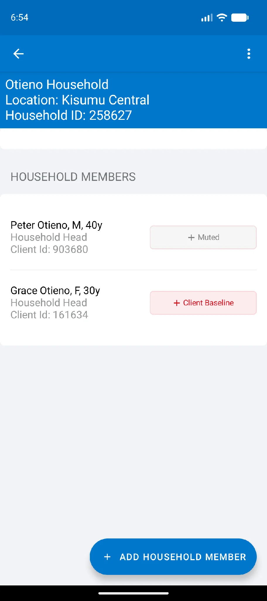

</Figure>

### Unmuting a household member

1. Open the household of the member through the All Households register, then tap the household member.

<Figure caption="Selecting a muted member">

</Figure>

2. On the member profile, tap the menu in the top right corner (three vertical dots).
3. Tap **Unmute**.

<Figure caption="Opening the Unmute option">

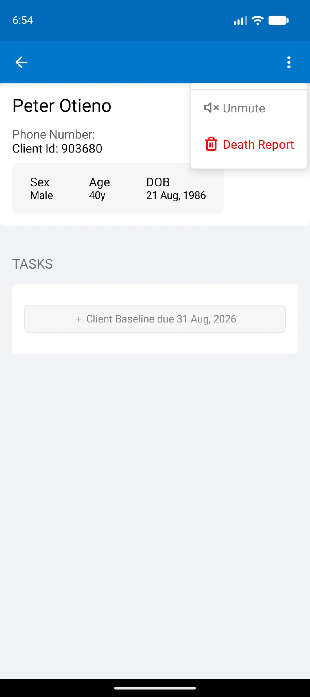

</Figure>

4. The **Unmute** form opens. Confirm that you want to unmute and tap **SAVE**.

<Figure caption="Unmute form">

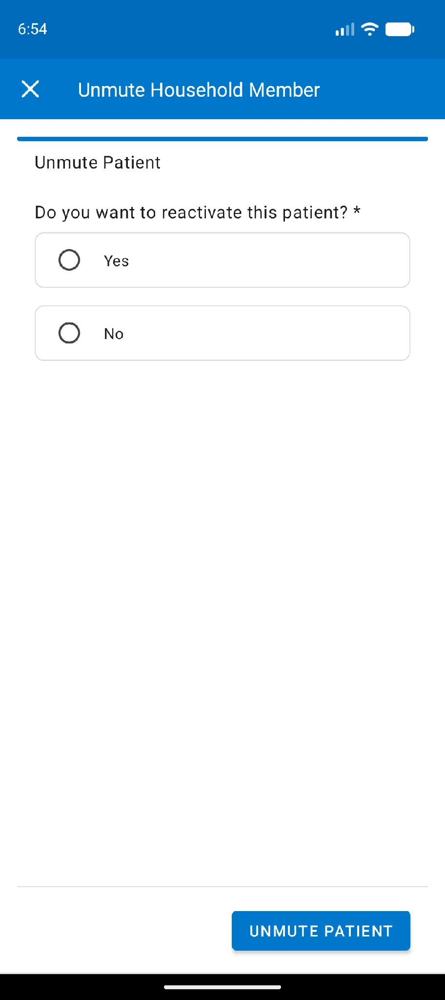

</Figure>

5. After unmuting, all the client's tasks are reactivated and services can be provided again.

## The client profile in the household register

From the household register you can open a client's profile and carry out tasks such as editing the registration information, registering the member into other registers, or removing them from the app.

1. Select a household from the All Households register to open its profile.
2. Tap a member of the household. Their profile shows:

   - The member's name
   - Their role in the household, such as household head
   - Phone number
   - Unique ID, generated by the system during registration
   - Demographic details: age, sex and date of birth
   - Tasks

<Figure caption="Client profile">

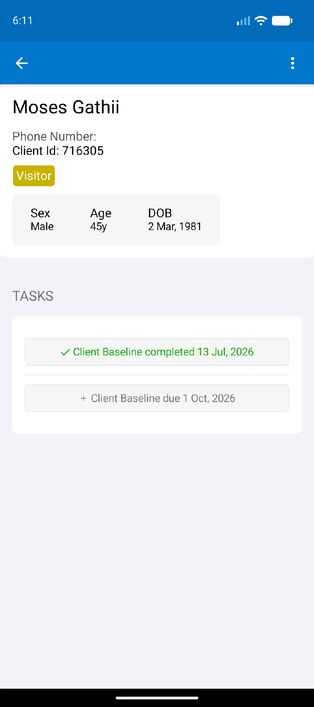

</Figure>
