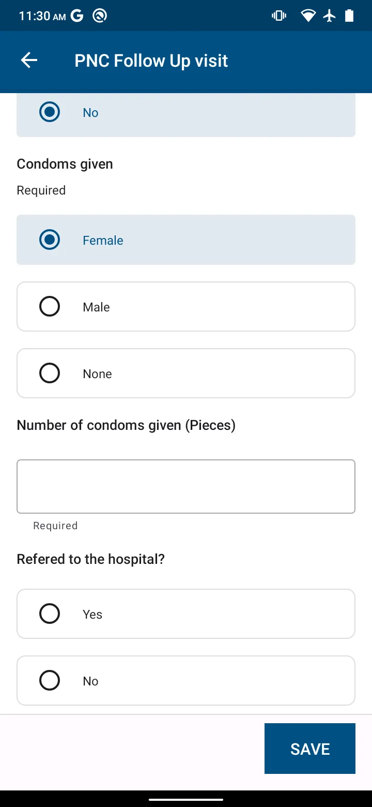
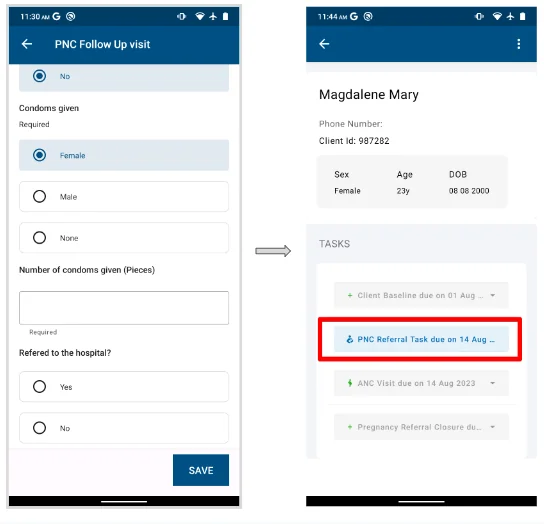

import Figure from '@site/src/components/Figure';

Workflow overview: [Maternal and newborn continuity](../../workflows/maternal-newborn-continuity.md).

## Registering a mother into PNC

To enter the PNC register, a mother must have been:

1. Registered in a household in the All Households register
2. Recorded as pregnant, and so listed in the ANC register
3. Given a birth outcome in the ANC register

Mothers in the ANC register move automatically to the **PNC register** once the outcome of their pregnancy is recorded. See [Recording a pregnancy outcome](./antenatal-care.mdx#recording-a-pregnancy-outcome).

## Recording a PNC home visit

During the first six weeks after birth, PNC home visits include tasks for the mother as well as the baby or babies. After six weeks the mother is removed from the PNC register automatically.

1. Select a mother's record from the PNC register and tap **Record PNC visit**. The PNC home visit form opens.
2. Fill in the form:

   - Confirm whether the mother has a child health card. If not, a referral question is shown
   - If the mother has a child health card, record the baby's weight, evaluate the mother for danger signs, and evaluate the baby for danger signs

3. Once a mother has delivered, or a birth outcome has been recorded, she becomes eligible for family planning. A mother can take up a birth control method at delivery or some time after birth. When she chooses a family planning method, record it during a PNC home visit. See [Family planning](./family-planning.mdx).

<Figure caption="Recording a PNC home visit">

</Figure>

## PNC client referral

A PNC mother may be unwell or show danger signs, or the child may be ill or show danger signs. These cases need an urgent visit to the health facility. The VHT can send the mother and/or child to the health facility they are linked to through the referral system. A PNC referral is made during the PNC home visit. Once a referral is made, a PNC referral task is shown. Workflow overview: [Referral and counter-referral](../../workflows/referral-counter-referral.md).

<Figure caption="Recording a referral for a PNC client">

</Figure>
