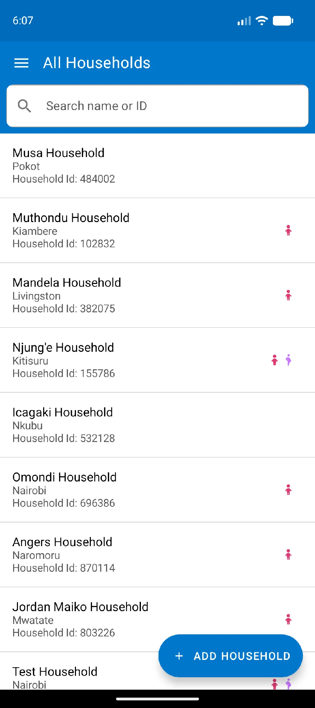
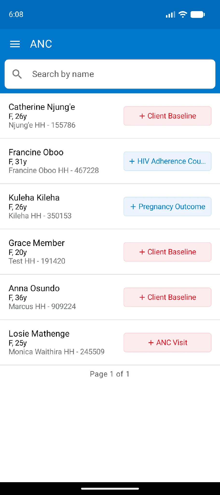
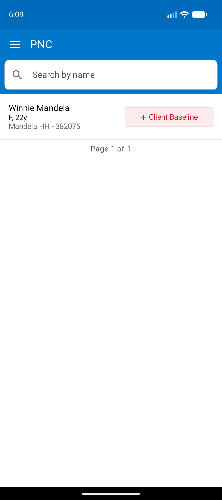
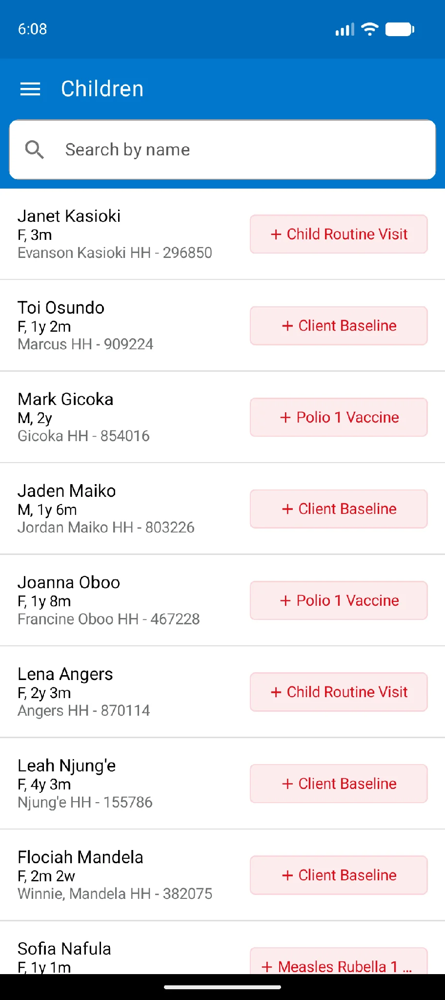
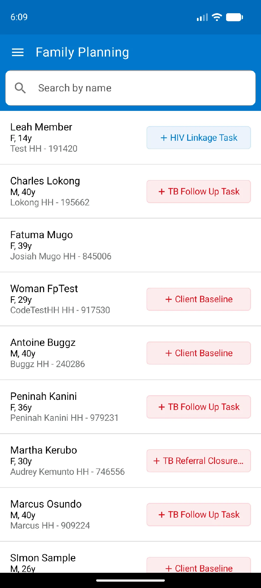
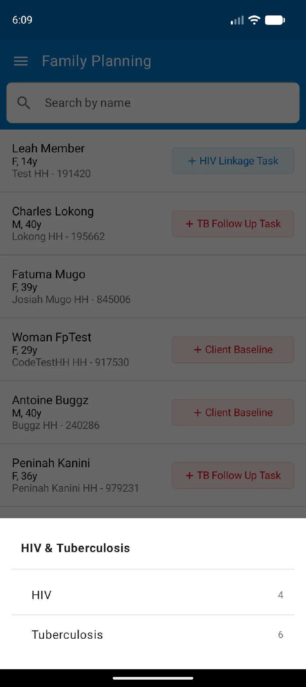
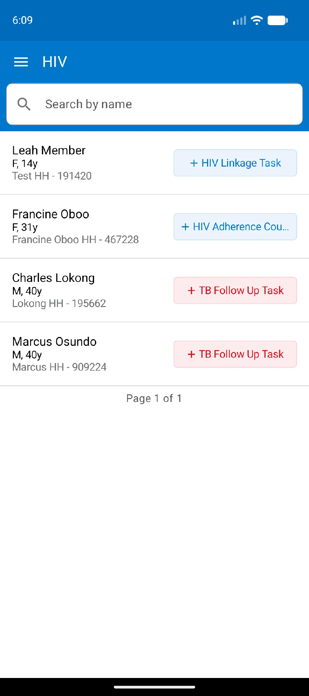
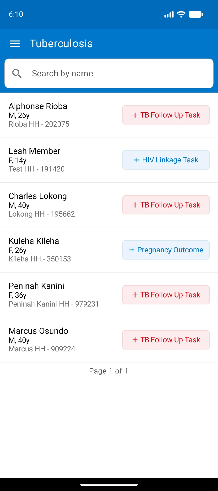
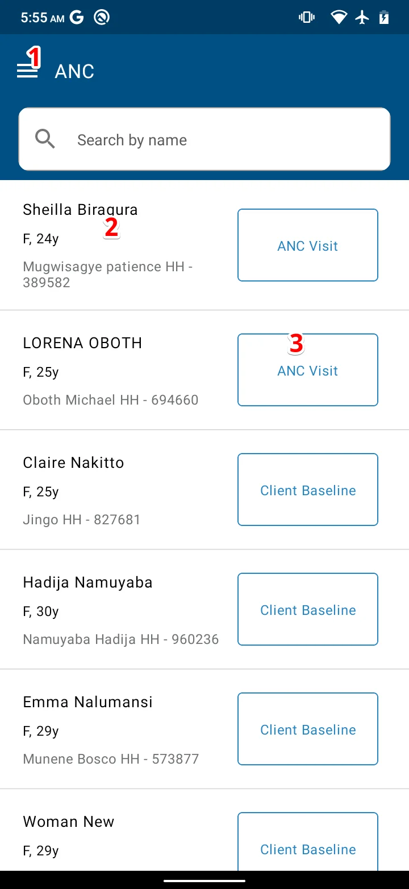
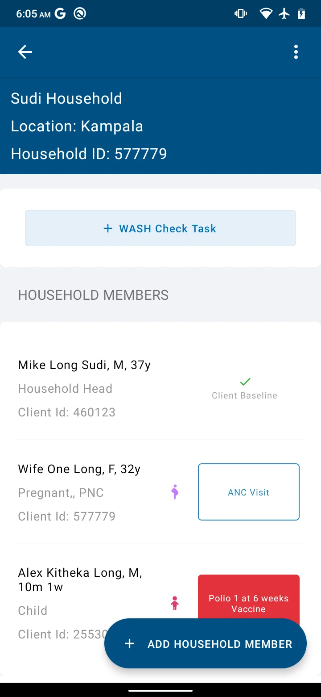

import Figure from '@site/src/components/Figure';

This chapter identifies the registers in the app, highlights what each one shows, and explains how to move around them.

## Identifying the registers

The side menu lists the registers and the other areas of the app: All Households, Tasks, Children, ANC, PNC, Family Planning, HIV and Tuberculosis, CEBS New Signals, CEBS History, Inventory, VHT Reports and Profile. Each register shows a count of the clients it holds.

:::note

HIV and Tuberculosis share one menu entry. Tap it to expand the two registers beneath it.

:::

<Figure caption="The side menu with its registers">

</Figure>

### All Households register

The **All Households** register groups clients by household. Each row shows:

1. The household name
2. The household village
3. The household ID
4. Icons representing the members of that household and their conditions, such as child clients and pregnant clients
5. The household status. This shows the total number of tasks to be performed as well as the overall status. The button appears red if the household has overdue tasks

<Figure caption="All Households register">

</Figure>

### ANC and PNC registers

The **ANC register** holds records of expectant mothers, while the **PNC register** holds women who have just delivered. Both show the mother's name, age and household.

<Figure caption="The ANC register and the PNC register">

</Figure>

### Children register

In the **Children** register each child's record is listed individually with the information that identifies them: the child's name, age and household. Children whose records were updated most recently are listed first. The register also shows whether any service is upcoming, due or past due for the child.

<Figure caption="Children register">

</Figure>

### Family Planning register

The **Family Planning (FP) register** organizes clients who have taken up a family planning method. It shows the client's name, gender, age, household name and household ID, and any services that are upcoming, due or past due. The client whose record was updated most recently appears at the top.

<Figure caption="Family Planning register">

</Figure>

### HIV register

The HIV and Tuberculosis registers sit under one **HIV & Tuberculosis** entry in the side menu. Tap that entry to expand them, then tap the register you want.

<Figure caption="Expanding the HIV and Tuberculosis entry">

</Figure>

The **HIV register** shows all clients diagnosed with HIV, with two names, age, gender and household. Clients with the latest updates are at the top.

<Figure caption="HIV register">

</Figure>

### Tuberculosis register

The **Tuberculosis (TB) register** shows all clients diagnosed with TB, with two names, age, gender and household. Clients with the latest updates are at the top.

<Figure caption="TB register">

</Figure>

## Navigating the registers

### Register home page

From a register view, the numbered locations on the figure do the following:

1. Open the side menu
2. Open the client profile
3. Launch the named task

<Figure caption="Components of a register home page">

</Figure>

### Task status and colour codes

The right-hand column of every register shows tasks that are due, overdue, not due and completed. Each is displayed differently:

1. **Due tasks** are highlighted in **blue**. They show that members of a household have due services. The number inside the box is the number of due services. If the due tasks are follow-up visits, **Home visit** is written inside the blue box, meaning the VHT needs to visit the household to complete them.
2. **Overdue tasks** are shown in a **red box**. The number inside the box is the number of tasks past the time they were supposed to be completed.
3. **No due tasks** is shown by a **blank box**.
4. **Completed visit** is shown by a greyed-out button with a **green** icon. All the tasks that were due for that household member have been completed.

<Figure caption="Task status and colour codes">

</Figure>

See [Scheduled community visit](../../workflows/scheduled-community-visit.md) for how visits are scheduled.
