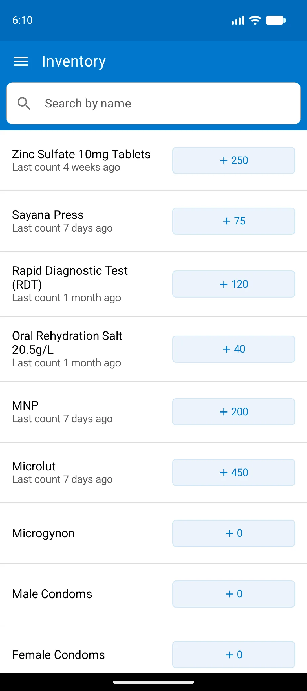
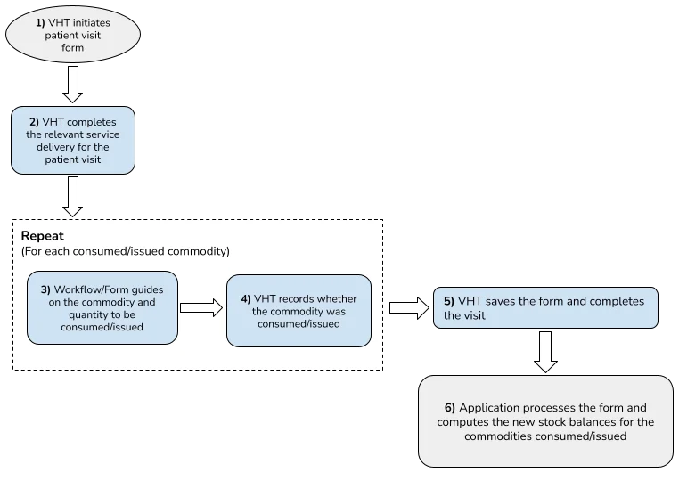
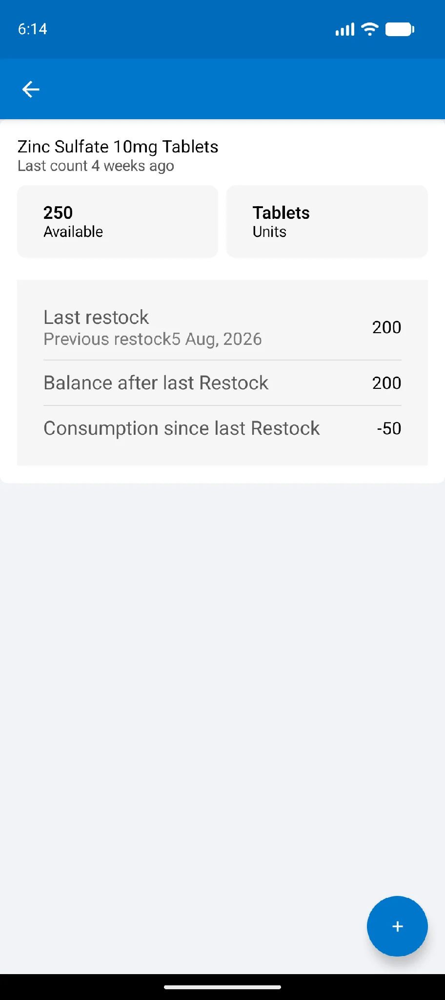
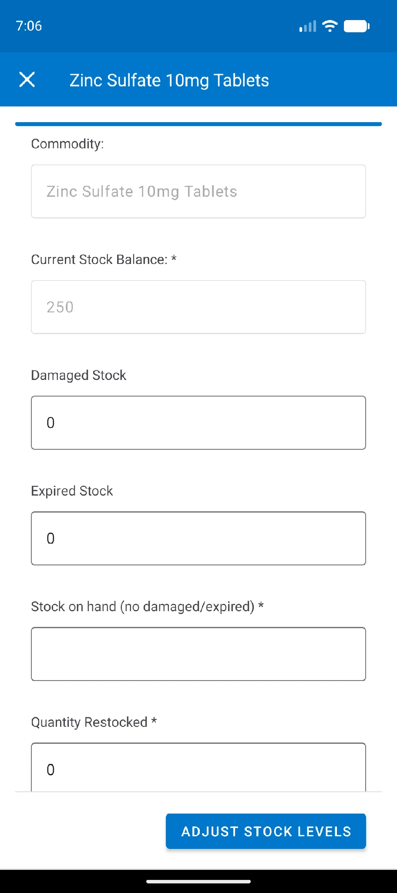
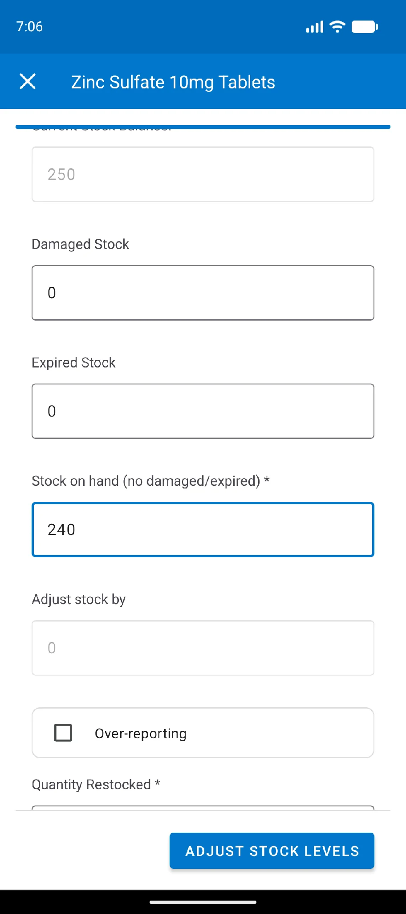

import Figure from '@site/src/components/Figure';

The stock management module provides basic commodity management. It covers stocks of ORS, zinc, artesunate, FP commodities (contraceptive pills, both POP and COC, condoms, cycle beads and emergency contraceptives) and malaria treatment, as well as rapid diagnostic test (RDT) kits for malaria. All inventory is calculated automatically from actions in the app, that is, the stock the VHT has issued during the month. Workflow overview: [Community commodity management](../../workflows/community-commodity-management.md).

## Viewing the stock on hand

Open the side menu and tap **Inventory**. The commodity register opens and shows:

1. The list of commodities
2. The commodity name
3. The date of the last physical verification
4. The current stock on hand, based on consumption

<Figure caption="Opening the commodities register">

</Figure>

## Commodity consumption

Commodity consumption is recorded automatically during service delivery. Once a commodity is recorded as issued, the app deducts the amount issued from the available stock and computes a new balance.

<Figure caption="Commodity consumption">

</Figure>

## Commodity profile

Tap a commodity in the inventory to open its profile, which shows the commodity's usage.

<Figure caption="Viewing the stock usage report for a commodity">

</Figure>

:::note

Stock usage reports are read-only. They can be viewed but not edited.

:::

## Recording a physical count and restock

1. Open the Inventory register.
2. Launch the **Physical count and restock** form, either by tapping the button on the right of the commodity or from the commodity profile.

<Figure caption="Launching the physical count and restock form">

</Figure>

3. Fill in the form:

| Field | Description | Required action | Edit |
|---|---|---|---|
| Commodity | The name of the commodity | None | Not editable |
| Current stock balance | The current stock on hand as calculated by the app | None | Not editable |
| Damaged stock | Commodities that were damaged | Record the number of damaged items | Editable |
| Expired stock | Commodities that have expired | Record the number of expired items | Editable |
| Stock on hand | The count from physical verification. This is what the VHT has before any restock | Fill in the count | Editable |
| Adjust stock by | Shown when the stock on hand does not match the current stock balance | Record the reasons for the difference. A count below the current balance offers "Over-reporting". For each reason selected, enter the number | Editable |
| Quantity restocked | The amount received from the supervisor | Record the amount received | Editable |

Entering a stock on hand that differs from the current balance reveals the **Adjust stock by** field together with a reason.

<Figure caption="Adjust stock by field revealed by a mismatched count">

</Figure>
